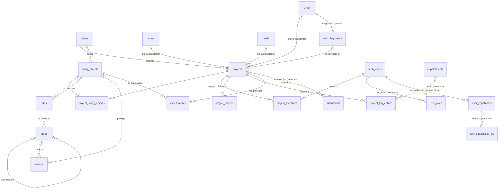
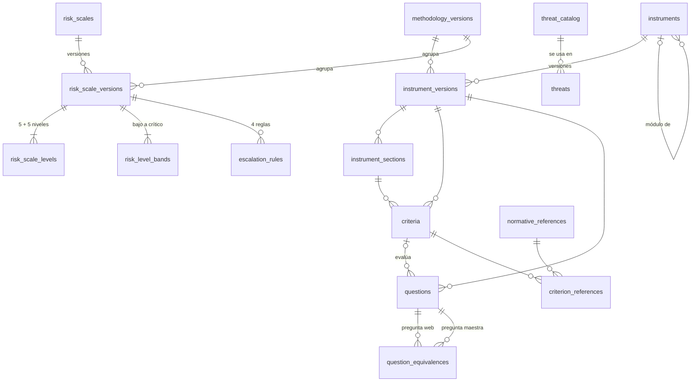
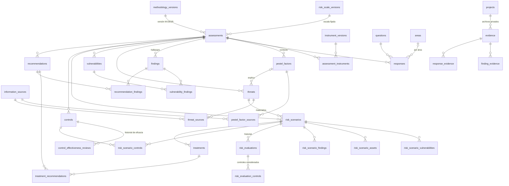
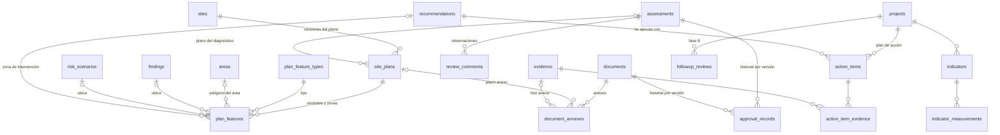

# M-DESR · Documento 02 · Modelo lógico y diccionario de datos

| Ficha | |
|---|---|
| Metodología | M-DESR, Metodología de Diagnóstico Estratégico de Seguridad y Riesgos |
| Documento | 02 · Modelo lógico y diccionario de datos |
| Versión | 0.4, borrador para revisión del titular (decisiones del 23-nov-2026) |
| Fecha | 22 de noviembre de 2026 |
| Parte de | Documento 01, que define la metodología: 4 niveles, 8 fases, entidades conceptuales y entregables |
| Base de datos de referencia | Supabase de producción `xtfsqdwkbsghkzszpisz`, leída solo desde el repositorio. No se consultó ni se modificó |
| Borrador SQL | [`supabase/setup/propuestas/10-m-desr-modelo.sql`](../../supabase/setup/propuestas/10-m-desr-modelo.sql), **NO EJECUTADO** |
| Revisión cruzada | [`03-revision-cruzada-02-09.md`](03-revision-cruzada-02-09.md): scripts 02 y 09 contra este documento |

> M-DESR es una metodología propia de STRATEC. Toma como referencia ISO 31000, ISO 22301, ISO 22341, ISO 20121, los criterios del CENAPRED y la normativa de Protección Civil. No es una certificación ni una norma oficial, y ningún entregable debe presentarse así.

---

## 1. Resumen

- El panel actual ya tiene clientes, prospectos, cotizaciones, documentos, agenda, oportunidades y permisos por rol. M-DESR **se monta encima** de eso:
  - el cliente sigue siendo `clients`;
  - la cotización sigue siendo `quotes`;
  - cada entregable sigue siendo un registro de `documents`.
- Hoy, los hallazgos, riesgos y recomendaciones de un documento viven dentro de un solo campo de texto estructurado (`documents.data`). Eso basta para redactar un informe, pero no sirve para la metodología: no guarda historial, no separa el riesgo inherente del residual, no liga evidencias y no permite aprobar por versión.
- El modelo agrega unas **65 tablas nuevas**, en 8 etapas. Ninguna borra ni cambia datos existentes. Solo dos tablas actuales se amplían con columnas opcionales:
  - `documents`, para ligar el entregable a su proyecto y llevar su versión;
  - `app_role` ya recibe el rol **Consultor** en el script 09, que se usa tal cual.
- Las reglas importantes las hace cumplir **la base de datos** y no solo las pantallas:
  - nadie aprueba su propio trabajo;
  - un diagnóstico cerrado no cambia;
  - el riesgo residual siempre lleva justificación escrita;
  - cada evaluación queda en el historial;
  - cada proyecto solo lo ven sus miembros asignados.
- Los cambios se prueban primero en un proyecto de Supabase **de pruebas**. El titular pega cada script en producción solo cuando la etapa queda aprobada.

---

## 2. Inventario de lo que existe hoy

Revisado en `origin/main` (commit `7bea3e2`, del 21 de noviembre de 2026).

### 2.1 Scripts y su estado en producción

| Script | Qué crea | ¿Está en producción? |
|---|---|---|
| `supabase/migrations/2026051*–20260525*` | `profiles`, `user_roles`, `leads`, `clients`, `deals`, `activities`, `quotes`, `appointments`, `rate_limits`; enums `app_role`, `lead_status`, `lead_source`, `deal_stage`, `activity_type`, `quote_status`; funciones `has_role`, `has_any_role`, `touch_updated_at`, `handle_new_user` | **Sí.** Es la base sobre la que corre hoy el panel. Las reglas de permisos son las de la migración de mayo: escriben admin, analyst y operations, borra solo admin y lee cualquier rol |
| `migrations/20261106210000_create_documents.sql` | Tabla `documents` (folio, plantilla, estado, `data` en JSON) | **Sí** |
| `setup/01-tipos.sql` | Los mismos enums, en versión idempotente | Equivale a lo que ya existe |
| `setup/02-tablas-y-permisos.sql` | `access_rules`, `can_access()`, vistas `lead_contacts` y `client_contacts`; reemplaza todas las políticas del CRM | **No** |
| `setup/03-tarifas.sql` | `service_rates` y `quotes.hours_actual` | **No** (depende de 02) |
| `setup/propuestas/06-historial-precios.sql` | `quote_price_log` | **No** |
| `setup/propuestas/07-origen-whatsapp.sql` | Valor `whatsapp` en `lead_source` | **Sí** |
| `setup/propuestas/08-rol-asesor.sql` | Valor `advisor` en `app_role` y sus reglas en `access_rules` | **No** (depende de 02) |
| `setup/propuestas/09-consultor-y-facultades.sql` | Valor `consultant`, `user_capabilities`, `user_capabilities_log`, `role_capabilities()`, `has_capability()`; reglas de `access_rules` del Consultor y del Ejecutivo | **No**. El panel de `main` ya lo lee y avisa si falta |

Diferencias entre el código y la base real que conviene saber:

- `src/integrations/supabase/types.ts` ya describe `access_rules`, `service_rates`, las vistas de contacto y el rol `advisor`, que aún no existen en producción. Le falta el valor `whatsapp` de `lead_source`, que sí existe.
- Sin el script 02, la tabla `access_rules` no existe y la matriz de **Configuración → Niveles de acceso** no tiene efecto en la base.
- **Importante para M-DESR:** volver a correr el script 02 **borra todas las políticas** de `documents` y de las demás tablas del CRM. Las políticas que M-DESR agregue a `documents` deben volver a aplicarse después de cada ejecución de 02 (sección 13).

### 2.2 Tablas actuales que M-DESR usa

| Tabla | Campos que interesan | Cómo la usa M-DESR |
|---|---|---|
| `clients` | `id`, `name`, `industry`, `contact_name`, `status`, `owner_id`. Correo y teléfono solo por la vista `client_contacts` (cuando exista 02) | Dueño de los objetos de estudio y de los proyectos. **No se duplica** |
| `leads` | `id`, `full_name`, `organization`, `source`, `status` (`converted`), `notes` | Origen de un proyecto. El diagnóstico gratuito llega aquí |
| `deals` | `stage` (`diagnostico`, `propuesta`…), `client_id`, `lead_id` | Oportunidad comercial. Un proyecto puede nacer de una |
| `quotes` | `number`, `client_id`, `deal_id`, `status`, `items` (JSON con códigos STR-xx) | Cotización aceptada que da origen al proyecto. **No se duplica** |
| `documents` | `folio`, `template`, `title`, `client_id`, `quote_id`, `status` (`draft`, `review`, `final`, `delivered`), `data` | Cada entregable de M-DESR es un documento. **Se amplía, no se duplica** |
| `appointments` | `starts_at`, `client_id`, `lead_id` | Visitas de campo. Se podrán ligar desde la bitácora del proyecto |
| `user_roles`, `profiles` | Rol global del usuario | Rol base. Encima se agregan facultades por usuario y la función de cada persona en el proyecto |
| `access_rules` (si existe) | Ver y editar por rol y por módulo | Solo controla los módulos que ya existen. M-DESR usa la asignación al proyecto y las facultades |

### 2.3 Módulos del panel (`src/pages/app/*`)

| Módulo | Archivo | Datos que usa | Relación con M-DESR |
|---|---|---|---|
| Panel general | `Dashboard.tsx` | leads, deals, quotes, appointments | Mostrará más adelante los proyectos y pendientes de aprobación |
| Prospectos | `Leads.tsx` | `leads` | Botón futuro: “Convertir diagnóstico en proyecto” |
| Clientes | `Clients.tsx` | `clients` | Sin cambios |
| Cotizaciones | `Quotes.tsx`, `lib/pricing.ts`, `lib/quoteCatalog.ts` | `quotes`, `service_rates` | El proyecto se liga a la cotización aceptada. Las recomendaciones llevan código STR-xx |
| Documentos | `Documents.tsx`, `lib/documentTemplates.ts`, `lib/documentPdf.ts` | `documents` | Los 9 tipos de plantilla siguen. Se agregan los 5 entregables de M-DESR, que se llenan desde las tablas nuevas |
| Pipeline | `Pipeline.tsx` | `deals`, `activities` | Sin cambios |
| Agenda | `Agenda.tsx` | `appointments` | Visitas de campo |
| Usuarios | `Placeholders.tsx`, `components/app/AccessMatrix.tsx`, `CreateUserForm.tsx` | `profiles`, `user_roles`, `access_rules` | Se agrega el rol Consultor y la pantalla de facultades por usuario |
| En preparación | `EnPreparacion.tsx` y `components/app/panelNav.ts` | Ninguno | Ya muestra los 5 módulos de M-DESR: Proyectos, Inmuebles y sedes, Inspecciones y diagnósticos, Análisis de riesgos y Planes de tratamiento (sección 3.2) |

Roles que existen hoy (`app_role` y `src/lib/access.ts`):

| Rol | Etiqueta | Permisos por defecto |
|---|---|---|
| `admin` | Administrador | Todo, incluido borrar y administrar usuarios |
| `analyst` | Analista | Edita prospectos, clientes, pipeline y agenda |
| `operations` | Operaciones | Igual que Analista |
| `advisor` | Asesor | Igual que Operaciones (script 08, sin aplicar) |
| `consultant` | Consultor | Clientes y agenda en lectura; documentos en lectura y edición (script 09, sin aplicar; ver H-01) |
| `executive` | Ejecutivo | Desde el 21-nov-2026: modifica lo comercial y operativo y consulta documentos (scripts 02 y 09) |
| `viewer` | Solo lectura | Solo lectura |

### 2.4 Lo que ya hay de diagnóstico, riesgo y mapa

| Pieza | Dónde | Cómo funciona hoy | Qué le falta para M-DESR |
|---|---|---|---|
| Hallazgo | `documentTemplates.ts` → `Finding` | `area`, `description`, `severity` (baja a crítica), dentro de `documents.data` | Ser un registro propio, con evidencia, origen y liga al riesgo |
| Riesgo | `Risk` | `name`, `cause`, `consequence`, `probability` 1–5, `impact` 1–5, `controls` y `treatment` en texto | Separar escenario y evaluación, guardar inherente y residual con historial, aplicar las reglas de escalamiento y usar controles evaluados |
| Escala | `PROBABILITY_LABEL`, `IMPACT_LABEL`, `riskLevel()` | 5×5 fija en el código: Bajo 1–4, Medio 5–9, Alto 10–15, Crítico 16–25 | Pasar a la base con versión, para que un diagnóstico cerrado conserve la escala con la que se evaluó |
| Acción | `Action` | `action`, `priority`, `term`, `responsible` | Seguimiento: estado, avance, evidencia y fechas |
| Dictamen | `Verdict` | favorable, condicionado o no favorable | Sin cambio |
| Mapa | `components/security-map/SecurityMap.tsx` y `types.ts` | Leaflet con satélite de Esri. Marcadores tipo punto (`vulnerabilidad`, `acceso`, `punto_ciego`, `camara`, `perimetro`, `critico`) con `lat` y `lng`. **No se guardan**: el diagnóstico web solo envía cuántos marcadores hubo | Guardar geometrías (puntos, líneas y polígonos), medidas, tipos de símbolo, cobertura de cámaras y versión del plano. La sesión del módulo de mapeo (rama `mapa`) eligió MapLibre con satélite de Esri |
| Diagnóstico gratuito | `src/pages/Diagnostico.tsx`, `DiagnosticoResidencial.tsx`, `DiagnosticoEventos.tsx`, `src/data/diagnosticoPreguntas.ts` | 3 cuestionarios (negocio, casa y evento) de 10 preguntas Sí / No / No estoy seguro. Puntaje de 0 a 10. Llega a `submit-lead` y se guarda **como texto** en `leads.notes` | Guardar cada respuesta por separado para convertirla en proyecto (sección 12) |
| Almacenamiento de archivos | — | No hay buckets de Storage en uso | Bucket privado de evidencias (sección 7.4) |

---

## 3. De la idea al modelo: qué se reusa, qué se amplía y qué se crea

### 3.1 Mapeo de cada entidad conceptual del Documento 01

| Entidad conceptual | Decisión | Tabla o tablas |
|---|---|---|
| Cliente | **Reusar** | `clients` |
| Proyecto | Crear | `projects`, ligado a `clients` y opcionalmente a `quotes`, `deals` y `leads` |
| Objeto de estudio | Crear | `study_objects` (pertenece al cliente) y `project_study_objects` (N:M) |
| Ubicación | Crear | `sites` |
| Área | Crear | `areas` (jerárquica) |
| Activo | Crear | `assets` |
| Instrumento y sus versiones | Crear | `instruments`, `instrument_versions`, `instrument_sections`, `assessment_instruments` |
| Criterio | Crear | `criteria`, `normative_references`, `criterion_references` |
| Pregunta | Crear | `questions`, `question_equivalences` |
| Respuesta | Crear | `responses` |
| Factor PESTEL | Crear | `pestel_factors` |
| Fuente (trazabilidad) | Crear | `information_sources`, `pestel_factor_sources`, `threat_sources` |
| Hallazgo | Crear (hoy vive en `documents.data`) | `findings` |
| Amenaza | Crear | `threat_catalog` (biblioteca) y `threats` (en el diagnóstico) |
| Vulnerabilidad | Crear | `vulnerabilities`, `vulnerability_findings` |
| Evidencia | Crear | `evidence` y tablas de asociación por entidad |
| Control y su eficacia | Crear | `controls`, `control_effectiveness_reviews`, `risk_scenario_controls` |
| Escenario de riesgo | Crear | `risk_scenarios` y sus asociaciones |
| Evaluación de riesgo | Crear | `risk_evaluations` (solo se agrega, nunca se edita) y `risk_evaluation_controls` |
| Escala y reglas de escalamiento | Crear | `risk_scales`, `risk_scale_versions`, `risk_scale_levels`, `risk_level_bands`, `escalation_rules` |
| Tratamiento | Crear | `treatments` |
| Recomendación | Crear | `recommendations`, `treatment_recommendations`, `recommendation_findings` |
| Acción | Crear | `action_items`, `action_item_evidence` |
| Revisión (seguimiento) | Crear | `followup_reviews` |
| Revisión técnica y aprobación | Crear | `approval_records`, `review_comments` |
| Indicador | Crear | `indicators`, `indicator_measurements` |
| Entregable | **Ampliar** | `documents` + `document_annexes` |
| Miembro del proyecto | Crear | `project_members` |
| Facultades por usuario | **Reusar** (script 09) | `user_capabilities`, `user_capabilities_log`, `role_capabilities()`, `has_capability()` |
| Bitácora | Crear | `project_log_entries` (bitácora del proyecto, la escribe el equipo) y `audit_log` (auditoría automática) |
| Plano del inmueble | Crear | `site_plans`, `plan_features`, `plan_feature_types` |
| Diagnóstico gratuito del sitio | Crear | `web_diagnostics` (ligado a `leads`) |
| Versión de la metodología | Crear | `methodology_versions` |

### 3.2 Correspondencia con los módulos “En preparación” del panel

| Módulo del menú | Ruta | Tablas principales |
|---|---|---|
| Proyectos | `/app/proyectos` | `projects`, `project_members`, `project_phases`, `project_log_entries`, `approval_records` |
| Inmuebles y sedes | `/app/inmuebles` | `study_objects`, `sites`, `areas`, `assets`, `site_plans`, `plan_features` |
| Inspecciones y diagnósticos | `/app/inspecciones` | `assessments`, `responses`, `pestel_factors`, `findings`, `threats`, `vulnerabilities`, `evidence` |
| Análisis de riesgos | `/app/riesgos` | `risk_scenarios`, `risk_evaluations`, `controls`, `control_effectiveness_reviews` |
| Planes de tratamiento | `/app/tratamiento` | `treatments`, `recommendations`, `action_items`, `followup_reviews`, `indicators` |
| Configuración → Metodología (nuevo) | `/app/settings` | `methodology_versions`, `instruments`, `risk_scales`, catálogos y facultades |

### 3.3 Proyecto y diagnóstico no son lo mismo

- **Proyecto** (`projects`) es el servicio contratado. Lleva el cliente, la cotización, el equipo, las 8 fases y los entregables.
- **Diagnóstico** (`assessments`) es una aplicación de M-DESR a un objeto de estudio en un momento dado. Fija la versión de la metodología, de los instrumentos y de la escala.
- Un proyecto puede tener varios diagnósticos. Por ejemplo, el diagnóstico inicial y un re-diagnóstico en la fase 8 de seguimiento.
- La aprobación y el cierre se hacen **por diagnóstico y por versión**.

---

## 4. Principios del modelo

1. **Solo se agrega.** Tablas, columnas opcionales, funciones y políticas nuevas. No se borra nada ni se cambia el significado de lo que existe.
2. **Nombres técnicos en inglés y `snake_case`**, como el resto de la base (`clients`, `quotes`). Las etiquetas en español viven en los catálogos y en el panel.
3. **Valores controlados con `text` más `CHECK`, y no con enums nuevos.** Agregar un valor a un enum obliga a correr el script en dos pasos, como pasó con los scripts 07 y 08. Un `CHECK` se cambia en un paso. Las listas que el administrador metodológico debe poder ampliar son tablas de catálogo. La excepción es `app_role`, que ya es enum y recibe el valor `consultant`.
4. **Llaves `uuid`** con `gen_random_uuid()`. Las bitácoras usan `bigint` autoincremental. Las tablas de asociación usan llave compuesta.
5. **Las fechas en `timestamptz`.** `created_at` y `updated_at` en todas las tablas editables; `updated_at` lo pone `touch_updated_at()`, que ya existe.
6. **Quién lo hizo lo pone el servidor** (`auth.uid()` por defecto o por trigger), nunca el navegador.
7. **JSON solo donde conviene:** geometrías GeoJSON, opciones de pregunta, propiedades de símbolos e instantáneas congeladas de entregables. Lo que se filtra, se relaciona o se aprueba va en columnas.
8. **Historial que solo crece:** `risk_evaluations`, `control_effectiveness_reviews`, `approval_records` y `audit_log` no tienen políticas de edición ni de borrado, y un trigger lo impide incluso con la llave de servicio.
9. **Nada se borra físicamente** en proyectos activos. Se usa un estado (`cancelado`, `descartada`, `retirada`). El borrado queda solo para borradores sin uso y siempre deja rastro en `audit_log`.
10. **La IA solo propone.** Todo registro que pueda venir de la IA lleva `origin = 'ia_propuesta'` y `review_status`. No entra a un entregable mientras una persona no lo acepte. La IA no puede crear fuentes ni cifras de criminalidad (regla R-19).

---

## 5. Roles, facultades y flujo de aprobación

Este apartado incorpora lo que aprobó el titular entre el 21 y el 23 de noviembre de 2026:

- el rol Consultor y las facultades por persona, ya publicados en `main` con el script [`09-consultor-y-facultades.sql`](../../supabase/setup/propuestas/09-consultor-y-facultades.sql), que aún no se ha ejecutado;
- el **criterio del Administrador del 23 de noviembre**, que sustituye al del 22: **tiene facultades técnicas por su rol**; su aprobación permite emitir el entregable; además reasigna clientes y proyectos;
- el Ejecutivo como rol comercial;
- el flujo con bloqueo de autoaprobación.

Este modelo **usa** las tablas y funciones del script 09 y no las duplica: `user_capabilities`, `user_capabilities_log`, `role_capabilities()` y `has_capability()`.

### 5.1 Tres capas de permiso

Una persona puede hacer un acto técnico en un proyecto solo si cumple **las tres** capas. **Excepción: el Administrador**, que tiene las facultades por su rol y puede actuar en cualquier proyecto sin estar asignado. Sus actos quedan siempre marcados como `administrador` (5.6).

| Capa | Dónde vive | Para qué sirve |
|---|---|---|
| 1. Rol global | `user_roles.role` (`app_role`) | Perfil base y facultades que trae el rol (`role_capabilities()`) |
| 2. Facultades por persona | `user_capabilities`, con bitácora en `user_capabilities_log` (script 09) | Facultades que el Administrador da a una persona además de las de su rol |
| 3. Asignación al proyecto | `project_members.project_function` | En qué proyectos y con qué función |

`has_capability(usuario, facultad)` del script 09 es la única fuente de facultades, y `mdesr_has_faculty()` la usa tal cual. Devuelve verdadero si la facultad está en `user_capabilities` o la trae el rol. Para `mdesr.validate`, `mdesr.approve` y `mdesr.close` exige ser Consultor **o Administrador**; ese es el ajuste del 23-nov que le toca a la sesión del 09.

### 5.2 Los siete roles

| Rol (`app_role`) | Etiqueta | En M-DESR |
|---|---|---|
| `admin` | Administrador | **Todas las facultades técnicas por su rol**, más la de **reasignar** clientes y proyectos (`mdesr.reassign`). Elabora, valida, aprueba, rechaza y cierra en cualquier proyecto, asignado o no. **Su aprobación permite emitir el entregable.** Cada acto suyo queda marcado como `administrador`, nunca como “Consultor”. No aprueba lo que él mismo elaboró o modificó. Administra usuarios y facultades. En el CRM, todo |
| `consultant` | Consultor | **Máxima autoridad técnica y metodológica.** Su rol trae: revisar, validar, aprobar, rechazar, devolver para corrección, cerrar, administrar instrumentos y asignar revisor. **No** trae elaborar (`mdesr.prepare`): normalmente no es autor y así nunca bloquea su propia aprobación. **Solo ve los proyectos donde está asignado. No administra usuarios** |
| `analyst` | Analista | Su rol trae: elaborar, revisar, comentar y enviar. No se le pueden dar validar, aprobar ni cerrar: el script 09 lo impide |
| `operations` | Operaciones | El script 09 no le da facultades. Puede apoyar en campo si se le dan `mdesr.prepare` o `mdesr.comment` |
| `advisor` | Asesor | Sin facultades M-DESR por defecto |
| `executive` | Ejecutivo | Rol comercial: consulta y modifica lo comercial y operativo (prospectos, clientes, contactos, pipeline, agenda, cotizaciones y analítica). **Solo ve los documentos asignados** (D-19): los de proyectos donde está asignado, los de clientes a su cargo y los que él creó. No los modifica |
| `viewer` | Solo lectura | Solo lectura de los proyectos donde está asignado |

### 5.3 Facultades

Lista y valores por rol tomados de `role_capabilities()` en el script 09.

| Facultad | Qué permite | La trae el rol |
|---|---|---|
| `mdesr.prepare` | Elaborar: respuestas, PESTEL, hallazgos, escenarios, evaluaciones, tratamientos y recomendaciones | analyst |
| `mdesr.review` | Revisión técnica de una versión enviada | consultant, analyst |
| `mdesr.comment` | Observaciones sin cambiar el contenido | analyst |
| `mdesr.submit` | Enviar una versión a revisión | analyst |
| `mdesr.validate` | Validación técnica final | consultant |
| `mdesr.approve` | Aprobar la versión. **Un analista, solo con autorización expresa** | consultant |
| `mdesr.reject` | Rechazar: el trabajo no procede | consultant |
| `mdesr.return_for_correction` | Devolver para corrección | consultant |
| `mdesr.close` | Cerrar el diagnóstico | consultant |
| `mdesr.manage_instruments` | Versiones de la metodología, instrumentos, escalas y catálogos | consultant |
| `mdesr.assign_reviewer` | Asignar revisor y consultor validador | consultant |
| `mdesr.reassign` (**nueva**) | Reasignar un proyecto (una función de una persona a otra) o un cliente y sus proyectos activos a otro asesor o consultor, con motivo escrito | admin |

El Administrador las tiene **todas** por su rol, incluida `mdesr.reassign`.

Reglas de las facultades, según el script 09:

- Solo el Administrador da o quita facultades por persona. Cada cambio queda en `user_capabilities_log`.
- **Quitar** una facultad dada a una persona es borrar su fila. Desde ese momento la base deja de reconocerla, porque `has_capability()` consulta la tabla en cada acto. El panel solo actualiza sus botones al volver a cargar.
- **Retiro por persona (D-20, decidido):** el Administrador podrá quitarle a una persona una facultad que trae su rol sin cambiarle el rol. Se registra como un retiro en `user_capabilities`, que gana sobre el rol. Le toca al script 09.
- Revisión cruzada: [`03-revision-cruzada-02-09.md`](03-revision-cruzada-02-09.md), hallazgo H-05. Se recomienda que dar `mdesr.approve` o `mdesr.validate` a quien no es Consultor exija nota escrita. Hoy la nota es opcional.

### 5.4 Función de cada persona en el proyecto (`project_members.project_function`)

| Función | Qué hace | Facultad que necesita |
|---|---|---|
| `elaborador` | Arma el diagnóstico (Analista A) | `mdesr.prepare` |
| `revisor` | Revisión técnica (Analista B). **Opcional:** si el proyecto no tiene revisor, la versión pasa directo a validación o aprobación | `mdesr.review` |
| `consultor_validador` | Valida, aprueba y cierra | Rol `consultant` (o `admin`) y `mdesr.validate` o `mdesr.approve` |
| `apoyo_campo` | Captura respuestas y evidencias en la visita | `mdesr.prepare` |
| `observador` | Solo lectura (por ejemplo, el Ejecutivo) | Ninguna; para comentar, `mdesr.comment` |

- Una persona puede tener varias funciones en un mismo proyecto, porque hay una fila por función.
- La regla de independencia (R-05) impide que esas funciones se crucen sobre **la misma versión**.

### 5.5 Flujo de un diagnóstico

```mermaid
stateDiagram-v2
    [*] --> borrador
    borrador --> enviado: enviar (elaborador)
    enviado --> en_revision: tomar_revision (revisor)
    en_revision --> devuelto: devolver
    en_revision --> revisado: revisar (favorable o con observaciones)
    revisado --> validado: validar (consultor)
    revisado --> devuelto: devolver
    validado --> aprobado: aprobar (consultor)
    validado --> devuelto: devolver
    devuelto --> borrador: corregir (elaborador; versión nueva)
    enviado --> rechazado: rechazar
    en_revision --> rechazado: rechazar
    revisado --> rechazado: rechazar
    validado --> rechazado: rechazar
    aprobado --> cerrado: cerrar
    aprobado --> borrador: reabrir por cambio sustancial (versión nueva, aprobación anulada)
    cerrado --> [*]
    rechazado --> [*]
```

- **La revisión técnica es opcional** (decisión del 23-nov). Si el proyecto tiene revisor asignado, la versión pasa por él. Si no, una versión `enviado` puede validarla el Consultor o aprobarla directamente el Administrador.
- Solo se edita el contenido en `borrador`. En los demás estados, el revisor y el consultor solo **comentan** (`review_comments`). Así, lo que se aprueba es exactamente lo que se revisó.
- Si el diagnóstico se devuelve, el elaborador lo abre con la acción `corregir`: vuelve a `borrador` con versión nueva.
- Los cambios de estado se hacen **solo** con `mdesr_transition(assessment_id, accion, comentario, decision)`. Un trigger rechaza cualquier cambio directo de `assessments.status`.
- **Cambio sustancial:** reabrir sube `revision_no`, registra `invalidar` sobre la versión anterior y regresa a `borrador`. Lo de la versión anterior **queda en el historial, pero ya no cuenta**.
- `cerrado` no tiene salida (R-09). Si después hace falta corregirlo, se crea un `rediagnostico` que lo referencia.
- Los entregables (`documents`) siguen el mismo flujo con su propio `revision_no`, con la función `mdesr_document_transition`. Si cambia `documents.data` de un entregable aprobado, vuelve a `draft`, sube de versión y se registra la invalidación (R-12).

### 5.6 Autoaprobación, independencia y actos del Administrador

Comprobaciones de `mdesr_transition` en la base:

| Regla | Comprobación |
|---|---|
| Nadie revisa, valida, aprueba ni cierra su propio trabajo | Es **autor** de la versión quien la envió o quien tiene cualquier cambio de contenido en `audit_log` desde que empezó esa versión. Aplica a todos, incluido el Administrador (D-24) |
| Validar, aprobar, rechazar y cerrar | Exigen el rol `consultant` con la facultad y la función `consultor_validador`, **o** el rol `admin`. Nunca puede hacerlo el autor ni el revisor de esa versión |
| Revisión opcional | Si el proyecto tiene revisor activo, la versión pasa por él. Si no, de `enviado` se puede validar (Consultor) o aprobar directamente (Administrador) |
| Aprobación del Consultor | De una versión `validado` |
| Aprobación del Administrador | De una versión `validado`, `revisado`, o `enviado` si no hay revisor. **Permite emitir el entregable** (D-18) |
| El Consultor autor no se aprueba | Si fue autor, aprueba otro Consultor o el Administrador |

La autoridad de cada acto la calcula `mdesr_authority()` y queda en `approval_records.authority_basis`. Para la versión vigente, también en `validation_basis` y `approval_basis` del diagnóstico.

| Valor | Cuándo |
|---|---|
| `administrador` | Es Administrador y tiene la facultad por su rol, asignado o no al proyecto |
| `funcion_asignada` | Tiene la función en el proyecto y la facultad por su rol técnico |
| `facultad_expresa` | Tiene la función y la facultad dada a su persona en `user_capabilities` |
| `sistema` | Lo hizo un trigger, como la invalidación automática de un entregable |

Así, el expediente y el entregable distinguen siempre “Aprobado por el Consultor” de “Aprobado por el Administrador”.

Toda asignación, revocación, reasignación e intervención queda en bitácora:

- las facultades, en `user_capabilities_log`;
- los equipos y las reasignaciones, en `audit_log` y en la bitácora del proyecto;
- los actos del flujo, en `approval_records`.

### 5.7 Historial de aprobación

- `approval_records` guarda **cada acto**: enviar, tomar revisión, revisar, devolver, corregir, validar, aprobar, rechazar, cerrar, reabrir e invalidar.
- Cada registro lleva:
  - el diagnóstico o el documento, y el número de versión;
  - quién lo hizo, con qué roles, con qué función en el proyecto y **con qué autoridad**;
  - la decisión, las observaciones y la fecha;
  - la versión de M-DESR, de los instrumentos y de la escala aplicadas;
  - la huella del contenido (`content_hash`).
- La tabla solo crece: no se edita ni se borra.
- Quién dio o quitó facultades a cada persona queda en `user_capabilities_log` (script 09).

---

## 6. Diagramas entidad-relación

Para que se puedan leer, el modelo se divide en cuatro diagramas. Las tablas que ya existen están marcadas como **existente**. Cardinalidades: `||--o{` es uno a muchos; `}o--o{` se resuelve siempre con una tabla de asociación explícita.

### 6.1 Proyecto, objeto de estudio, equipo y permisos

### 6.2 Biblioteca metodológica (versionada)

### 6.3 Diagnóstico, riesgo e intervención

### 6.4 Plano, aprobación, entregables y seguimiento

---

## 7. Diccionario de datos

**Columnas comunes.** Para no repetirlas en cada tabla:

| Campo | Tipo | Oblig. | Defecto | Descripción |
|---|---|---|---|---|
| `id` | `uuid` | Sí | `gen_random_uuid()` | Llave primaria (salvo donde se indique otra) |
| `created_at` | `timestamptz` | Sí | `now()` | Alta |
| `updated_at` | `timestamptz` | Sí | `now()` | Última edición. La pone el trigger `touch_updated_at` |
| `created_by` | `uuid` → `auth.users` | No | `auth.uid()` | Quién lo creó. Lo pone el servidor |
| `origin` | `text` | Sí | `'consultor'` | `consultor`, `cliente`, `diagnostico_web` o `ia_propuesta` |
| `review_status` | `text` | Sí | `'aceptada'`, o `'propuesta'` si `origin = 'ia_propuesta'` | `propuesta`, `aceptada`, `editada` o `descartada`. Solo entra al entregable lo que está `aceptada` o `editada` |

En la columna “Oblig.”, **Sí** quiere decir `NOT NULL`. “FK” es llave foránea y, entre paréntesis, lo que pasa al borrar el registro padre.

### 7.1 Gobierno: roles, facultades y versión de la metodología

**`app_role`, `user_capabilities`, `user_capabilities_log`, `role_capabilities()` y `has_capability()`.** Los crea el script [`09-consultor-y-facultades.sql`](../../supabase/setup/propuestas/09-consultor-y-facultades.sql). Este modelo no los redefine.

| Objeto | Campos o firma | Notas |
|---|---|---|
| `app_role` | Agrega `consultant` | Paso 1 aparte del script 09 |
| `user_capabilities` | `user_id`, `capability` (PK compuesta), `granted_by`, `granted_at`, `note` | Solo el Administrador escribe. Cada persona lee las suyas |
| `user_capabilities_log` | `id`, `user_id`, `capability`, `action` (`grant`, `revoke`, `update`), `changed_by`, `changed_at`, `note` | La llena un trigger. Solo la lee el Administrador |
| `role_capabilities(text)` | Devuelve `text[]` | Facultades por rol (5.3). Debe coincidir con `src/lib/capabilities.ts` |
| `has_capability(uuid, text)` | Devuelve `boolean` | Admin: siempre verdadero |

**Funciones propias de M-DESR** (borrador 10): `mdesr_has_faculty(facultad)`, que envuelve a `has_capability()` con el usuario actual, y `mdesr_authority(proyecto, funciones, facultad)`, que devuelve la base de autoridad de 5.6.

**`methodology_versions`.** Versión de M-DESR que aplica cada diagnóstico.

| Campo | Tipo | Oblig. | Defecto | Descripción |
|---|---|---|---|---|
| `label` | `text` único | Sí | | Por ejemplo `1.0` |
| `title` | `text` | Sí | | `M-DESR 1.0` |
| `document_ref` | `text` | No | | Documentos que la definen, como “Doc. 01 v1.0; Doc. 02 v1.0” |
| `status` | `text` | Sí | `'borrador'` | `borrador`, `publicada` o `retirada` |
| `published_at`, `published_by` | `timestamptz`, `uuid` | No | | Los llena la publicación |
| `change_notes` | `text` | No | | Qué cambió respecto a la anterior |

### 7.2 Núcleo del proyecto

**`projects`**

| Campo | Tipo | Oblig. | Defecto | Descripción |
|---|---|---|---|---|
| `code` | `text` único | Sí | | Folio, por ejemplo `PRY-2026-001` |
| `name` | `text` | Sí | | Nombre corto del servicio |
| `client_id` | `uuid` FK `clients` (restrict) | Sí | | Cliente. **Reusa** `clients` |
| `quote_id` | `uuid` FK `quotes` (set null) | No | | Cotización que lo origina |
| `deal_id` | `uuid` FK `deals` (set null) | No | | Oportunidad |
| `lead_id` | `uuid` FK `leads` (set null) | No | | Prospecto de origen |
| `sector_module` | `text` | Sí | | `residencial`, `empresarial_institucional`, `eventos_masivos` o `instalaciones_estrategicas` |
| `objective` | `text` | No | | Objetivo |
| `scope` | `text` | No | | Alcance acordado (interno; no se publica) |
| `status` | `text` | Sí | `'propuesta'` | `propuesta`, `activo`, `suspendido`, `cerrado` o `cancelado` |
| `current_phase` | `smallint` | Sí | `1` | Fase actual, de 1 a 8 |
| `requires_independence` | `boolean` | Sí | `true` | Revisor y aprobador deben ser personas distintas (R-05) |
| `start_date`, `target_end_date` | `date` | No | | Fechas planeadas |
| `closed_at` | `timestamptz` | No | | Cierre |
| `owner_id` | `uuid` FK `auth.users` | No | `auth.uid()` | Responsable administrativo |
| `is_demo` | `boolean` | Sí | `false` | Proyecto ficticio para demostraciones. Nunca se mezcla con clientes reales |

**`project_members`**

| Campo | Tipo | Oblig. | Defecto | Descripción |
|---|---|---|---|---|
| `project_id` | `uuid` FK `projects` (cascade) | Sí | | |
| `user_id` | `uuid` FK `auth.users` (cascade) | Sí | | |
| `project_function` | `text` | Sí | | `elaborador`, `revisor`, `consultor_validador`, `apoyo_campo` u `observador` (5.4) |
| `assigned_by` | `uuid` | Sí | `auth.uid()` | Quien asignó. Para `revisor` y `consultor_validador` necesita `mdesr.assign_reviewer` |
| `assigned_at` | `timestamptz` | Sí | `now()` | |
| `removed_at`, `removed_by` | `timestamptz`, `uuid` | No | | Baja. No se borra la fila |
| `notes` | `text` | No | | |

Índice único: (`project_id`, `user_id`, `project_function`) mientras `removed_at` sea nulo.

**`project_phases`** (8 filas por proyecto; las crea un trigger al dar de alta el proyecto)

| Campo | Tipo | Oblig. | Defecto | Descripción |
|---|---|---|---|---|
| `project_id` | `uuid` FK `projects` (cascade) | Sí | | PK (1/2) |
| `phase` | `smallint` | Sí | | PK (2/2). De 1 a 8, ver el catálogo C-01 |
| `status` | `text` | Sí | `'pendiente'` | `pendiente`, `en_curso`, `completada` o `no_aplica` |
| `started_at`, `completed_at` | `timestamptz` | No | | |
| `completed_by` | `uuid` | No | | |
| `notes` | `text` | No | | Justificación, obligatoria si es `no_aplica` |

**`study_objects`** (objeto de estudio)

| Campo | Tipo | Oblig. | Defecto | Descripción |
|---|---|---|---|---|
| `client_id` | `uuid` FK `clients` (restrict) | Sí | | Dueño |
| `name` | `text` | Sí | | “Planta Jiutepec”, “Residencia Lomas”, “Festival 2027” |
| `object_type` | `text` | Sí | | `residencia`, `empresa`, `institucion`, `instalacion_estrategica`, `evento_masivo` u `otro` |
| `sector_module` | `text` | Sí | | Módulo sectorial que le aplica (los mismos 4 valores de `projects`) |
| `description` | `text` | No | | Uso, giro, características |
| `fixed_population`, `floating_population` | `integer` ≥ 0 | No | | Población fija y flotante |
| `operating_hours` | `text` | No | | Horario |
| `event_start`, `event_end` | `timestamptz` | No | | Solo eventos. `event_end` ≥ `event_start` |
| `expected_attendance` | `integer` ≥ 0 | No | | Solo eventos |
| `is_demo` | `boolean` | Sí | `false` | Ficticio |

**`project_study_objects`** (N:M, porque un inmueble puede estudiarse en varios proyectos y un proyecto puede abarcar varios inmuebles)

| Campo | Tipo | Oblig. | Defecto | Descripción |
|---|---|---|---|---|
| `project_id` | `uuid` FK (cascade) | Sí | | PK (1/2) |
| `study_object_id` | `uuid` FK (restrict) | Sí | | PK (2/2) |
| `is_primary` | `boolean` | Sí | `true` | Objeto principal del proyecto |

Regla: el objeto debe ser del mismo cliente que el proyecto (R-01).

**`sites`** (ubicación)

| Campo | Tipo | Oblig. | Defecto | Descripción |
|---|---|---|---|---|
| `study_object_id` | `uuid` FK (cascade) | Sí | | |
| `name` | `text` | Sí | | “Sede principal”, “Explanada norte” |
| `address_line`, `neighborhood`, `municipality`, `state`, `postal_code` | `text` | No | | Dirección |
| `country` | `text` | Sí | `'MX'` | |
| `latitude` | `numeric(9,6)` | No | | Entre −90 y 90 |
| `longitude` | `numeric(9,6)` | No | | Entre −180 y 180 |
| `geo_precision` | `text` | No | | `exacta`, `aproximada` o `municipio` |
| `is_primary` | `boolean` | Sí | `false` | Un solo principal por objeto (índice único parcial) |
| `notes` | `text` | No | | |

**`areas`**

| Campo | Tipo | Oblig. | Defecto | Descripción |
|---|---|---|---|---|
| `site_id` | `uuid` FK `sites` (cascade) | Sí | | |
| `parent_area_id` | `uuid` FK `areas` (set null) | No | | Sub-área. Debe estar en la misma ubicación |
| `name` | `text` | Sí | | Único por ubicación |
| `area_type` | `text` | Sí | `'otro'` | Catálogo C-05 |
| `criticality` | `smallint` 1–5 | No | | Importancia del área |
| `description` | `text` | No | | |

**`assets`** (activo)

| Campo | Tipo | Oblig. | Defecto | Descripción |
|---|---|---|---|---|
| `study_object_id` | `uuid` FK (cascade) | Sí | | |
| `area_id` | `uuid` FK `areas` (set null) | No | | Debe estar en una ubicación del mismo objeto (R-02) |
| `name` | `text` | Sí | | |
| `asset_type` | `text` | Sí | | `personas`, `instalaciones`, `equipos`, `informacion`, `procesos`, `bienes_valor`, `reputacion` u `otro` |
| `criticality` | `smallint` 1–5 | Sí | `3` | |
| `description`, `owner_name` | `text` | No | | |

**`project_log_entries`** (bitácora del proyecto; solo se agregan entradas)

| Campo | Tipo | Oblig. | Defecto | Descripción |
|---|---|---|---|---|
| `id` | `bigint` identity | Sí | | PK |
| `project_id` | `uuid` FK (cascade) | Sí | | |
| `assessment_id` | `uuid` FK (set null) | No | | |
| `entry_type` | `text` | Sí | `'nota'` | `visita`, `entrevista`, `reunion`, `revision_documental`, `incidente`, `decision` o `nota` |
| `occurred_at` | `timestamptz` | Sí | `now()` | Cuándo pasó (puede ser anterior al registro) |
| `summary` | `text` | Sí | | |
| `details` | `text` | No | | |
| `appointment_id` | `uuid` FK `appointments` (set null) | No | | Cita de la Agenda |
| `author_id` | `uuid` | Sí | `auth.uid()` | |

Las correcciones se hacen con una entrada nueva; no se edita la anterior.

**`audit_log`** (auditoría automática; ver R-16)

| Campo | Tipo | Oblig. | Defecto | Descripción |
|---|---|---|---|---|
| `id` | `bigint` identity | Sí | | PK |
| `occurred_at` | `timestamptz` | Sí | `clock_timestamp()` | |
| `actor_id` | `uuid` | No | `auth.uid()` | Nulo si fue el sistema o el SQL Editor |
| `table_name` | `text` | Sí | | |
| `record_id` | `text` | Sí | | Llave del registro |
| `project_id`, `assessment_id` | `uuid` | No | | Para filtrar y para la regla de autoría |
| `operation` | `text` | Sí | | `INSERT`, `UPDATE` o `DELETE` |
| `via_transition` | `boolean` | Sí | `false` | Lo escribió `mdesr_transition` (cambio de estado). No cuenta como autoría para R-04 |
| `old_data`, `new_data` | `jsonb` | No | | Antes y después |
| `changed_fields` | `text[]` | No | | Campos que cambiaron |

### 7.3 Biblioteca metodológica

> Todo lo de esta sección lo edita solo quien tiene `mdesr.manage_instruments`, y **solo mientras la versión está en `borrador`**. Al publicarse queda fija (R-08).

**`normative_references`**

| Campo | Tipo | Oblig. | Defecto | Descripción |
|---|---|---|---|---|
| `code` | `text` único | Sí | | `ISO-31000-2018`, `ISO-22301-2019`, `ISO-22341-2021`, `ISO-20121-2024`, `CENAPRED`, `LGPC`, `LPC-MOR`… |
| `title` | `text` | Sí | | |
| `issuer` | `text` | No | | ISO, CENAPRED, Congreso del Estado… |
| `edition_year` | `smallint` | No | | |
| `reference_type` | `text` | Sí | | `norma_internacional`, `norma_mexicana`, `ley`, `reglamento`, `guia_oficial` o `buena_practica` |
| `jurisdiction` | `text` | Sí | | `internacional`, `federal`, `estatal` o `municipal` |
| `url`, `notes` | `text` | No | | |
| `active` | `boolean` | Sí | `true` | |

**`instruments`**

| Campo | Tipo | Oblig. | Defecto | Descripción |
|---|---|---|---|---|
| `code` | `text` único | Sí | | `MDESR-MAESTRO`, `MDESR-RES`, `MDESR-EMP`, `MDESR-EVM`, `MDESR-IES`, `WEB-NEGOCIO`, `WEB-CASA`, `WEB-EVENTO` |
| `name` | `text` | Sí | | |
| `kind` | `text` | Sí | | `maestro`, `modulo_sectorial` o `version_corta_web` |
| `sector_module` | `text` | Condicional | | Obligatorio si es `modulo_sectorial` |
| `web_type` | `text` | Condicional | | `negocio`, `casa` o `evento`. Obligatorio si es `version_corta_web` |
| `parent_instrument_id` | `uuid` FK `instruments` | No | | Los módulos y la versión web apuntan al maestro |
| `description` | `text` | No | | |
| `active` | `boolean` | Sí | `true` | |

**`instrument_versions`**

| Campo | Tipo | Oblig. | Defecto | Descripción |
|---|---|---|---|---|
| `instrument_id` | `uuid` FK (restrict) | Sí | | |
| `methodology_version_id` | `uuid` FK (restrict) | Sí | | |
| `version_label` | `text` | Sí | | Única por instrumento |
| `status` | `text` | Sí | `'borrador'` | `borrador`, `publicada` o `retirada` |
| `published_at`, `published_by` | | No | | |
| `change_notes` | `text` | No | | |
| `content_hash` | `text` | No | | Huella de secciones, criterios y preguntas al publicar |

**`instrument_sections`**

| Campo | Tipo | Oblig. | Defecto | Descripción |
|---|---|---|---|---|
| `instrument_version_id` | `uuid` FK (cascade) | Sí | | |
| `code` | `text` | Sí | | Único por versión |
| `title` | `text` | Sí | | |
| `methodology_level` | `text` | Sí | | `contexto`, `diagnostico`, `evaluacion` o `intervencion` |
| `phase` | `smallint` 1–8 | Sí | | Fase de M-DESR |
| `sort_order` | `integer` | Sí | `0` | |

**`criteria`**

| Campo | Tipo | Oblig. | Defecto | Descripción |
|---|---|---|---|---|
| `instrument_version_id` | `uuid` FK (cascade) | Sí | | |
| `section_id` | `uuid` FK `instrument_sections` (cascade) | Sí | | De la misma versión |
| `code`, `title` | `text` | Sí | | `code` es único por versión |
| `description` | `text` | No | | Qué se considera cumplido |
| `sort_order` | `integer` | Sí | `0` | |

**`criterion_references`** (N:M)

| Campo | Tipo | Oblig. | Descripción |
|---|---|---|---|
| `criterion_id` | `uuid` FK (cascade) | Sí | PK (1/2) |
| `normative_reference_id` | `uuid` FK (restrict) | Sí | PK (2/2) |
| `clause` | `text` | No | Cláusula o apartado, por ejemplo “6.4.2” |

**`questions`**

| Campo | Tipo | Oblig. | Defecto | Descripción |
|---|---|---|---|---|
| `instrument_version_id` | `uuid` FK (cascade) | Sí | | |
| `section_id` | `uuid` FK (cascade) | Sí | | |
| `criterion_id` | `uuid` FK (set null) | No | | |
| `code` | `text` | Sí | | Único por versión |
| `text` | `text` | Sí | | |
| `help_text` | `text` | No | | Guía para el evaluador |
| `answer_type` | `text` | Sí | `'si_no_ns'` | `si_no_ns`, `escala_1_5`, `opcion_unica`, `opcion_multiple`, `numero`, `texto` o `fecha` |
| `options` | `jsonb` | Condicional | | Lista de opciones. Obligatoria en `opcion_*` |
| `weight` | `numeric(6,2)` ≥ 0 | Sí | `1` | Peso en el puntaje |
| `is_critical` | `boolean` | Sí | `false` | Un incumplimiento exige un hallazgo |
| `requires_evidence` | `boolean` | Sí | `false` | La respuesta necesita al menos una evidencia antes de enviar a revisión |
| `applies_by_area` | `boolean` | Sí | `false` | Se responde una vez por área |
| `legacy_web_id` | `smallint` | No | | Número de pregunta en `src/data/diagnosticoPreguntas.ts` (1 a 10). Solo en instrumentos web |
| `sort_order` | `integer` | Sí | `0` | |

**`question_equivalences`** (N:M entre la pregunta corta web y la maestra)

| Campo | Tipo | Oblig. | Descripción |
|---|---|---|---|
| `web_question_id` | `uuid` FK `questions` (cascade) | Sí | PK (1/2). De un instrumento `version_corta_web` |
| `master_question_id` | `uuid` FK `questions` (cascade) | Sí | PK (2/2). Del maestro o de un módulo sectorial |
| `mapping_note` | `text` | No | Cómo se interpreta, por ejemplo “Sí en web = respuesta preliminar Sí; requiere verificación en campo” |

**`risk_scales`**, **`risk_scale_versions`**

| Tabla.campo | Tipo | Oblig. | Defecto | Descripción |
|---|---|---|---|---|
| `risk_scales.code` | `text` único | Sí | | `MDESR-5X5` |
| `risk_scales.name`, `description` | `text` | Sí / No | | |
| `risk_scale_versions.risk_scale_id` | `uuid` FK | Sí | | |
| `risk_scale_versions.methodology_version_id` | `uuid` FK | Sí | | |
| `risk_scale_versions.version_label` | `text` | Sí | | Única por escala |
| `risk_scale_versions.probability_levels`, `impact_levels` | `smallint` | Sí | `5` | |
| `risk_scale_versions.status`, `published_at`, `published_by`, `change_notes` | | | `'borrador'` | Igual que en los instrumentos |

**`risk_scale_levels`**

| Campo | Tipo | Oblig. | Descripción |
|---|---|---|---|
| `scale_version_id` | `uuid` FK (cascade) | Sí | |
| `axis` | `text` | Sí | `probabilidad` o `impacto` |
| `value` | `smallint` | Sí | De 1 a 5. Único por versión y eje |
| `label` | `text` | Sí | Probabilidad: Rara, Improbable, Posible, Probable, Casi segura. Impacto: Insignificante, Menor, Moderado, Mayor, Catastrófico (los mismos de `documentTemplates.ts`) |
| `descriptor` | `text` | No | Criterio para elegir el nivel |

**`risk_level_bands`**

| Campo | Tipo | Oblig. | Descripción |
|---|---|---|---|
| `scale_version_id` | `uuid` FK (cascade) | Sí | |
| `level_code` | `text` | Sí | `bajo`, `medio`, `alto` o `critico`. Único por versión |
| `label` | `text` | Sí | |
| `min_score`, `max_score` | `smallint` | Sí | Versión 1: 1–4, 5–9, 10–15 y 16–25. Sin huecos ni traslapes (se comprueba al publicar) |
| `color_hex` | `text` | No | |
| `required_response` | `text` | No | Qué atención exige el nivel |

**`escalation_rules`**

| Campo | Tipo | Oblig. | Descripción |
|---|---|---|---|
| `scale_version_id` | `uuid` FK (cascade) | Sí | |
| `criterion` | `text` | Sí | `vida_humana`, `evacuacion`, `integridad_estructural` o `cumplimiento_legal`. Único por versión |
| `minimum_level` | `text` | Sí | Nivel mínimo cuando aplica. Propuesta de valores en D-07 |
| `description` | `text` | Sí | Cuándo se considera que aplica |

**`threat_catalog`**

| Campo | Tipo | Oblig. | Defecto | Descripción |
|---|---|---|---|---|
| `code` | `text` único | Sí | | `AM-GEO-01`… |
| `name` | `text` | Sí | | Sismo, inundación, incendio, robo, extorsión telefónica, estampida… |
| `phenomenon` | `text` | Sí | | Catálogo C-07 |
| `description` | `text` | No | | |
| `sector_modules` | `text[]` | Sí | `'{}'` | Módulos en que aplica (vacío = todos) |
| `active` | `boolean` | Sí | `true` | |

### 7.4 Diagnóstico

**`assessments`** (diagnóstico)

| Campo | Tipo | Oblig. | Defecto | Descripción |
|---|---|---|---|---|
| `project_id` | `uuid` FK `projects` (restrict) | Sí | | |
| `study_object_id` | `uuid` FK (restrict) | Sí | | Debe estar ligado al proyecto (R-01) |
| `code` | `text` único | Sí | | `DX-2026-001` |
| `kind` | `text` | Sí | `'diagnostico_inicial'` | `diagnostico_inicial`, `rediagnostico` o `seguimiento` |
| `previous_assessment_id` | `uuid` FK `assessments` | No | | Obligatorio en `rediagnostico` |
| `methodology_version_id` | `uuid` FK (restrict) | Sí | | Debe estar `publicada`. No cambia después de crear el diagnóstico |
| `risk_scale_version_id` | `uuid` FK (restrict) | Sí | | Debe estar `publicada`. No cambia después de crear el diagnóstico |
| `status` | `text` | Sí | `'borrador'` | Ver 5.5. Solo cambia con `mdesr_transition` |
| `revision_no` | `integer` | Sí | `1` | Versión de contenido. Sube al reabrir o al corregir |
| `revision_started_at` | `timestamptz` | Sí | `now()` | Inicio de la versión. Sirve para la regla de autoría |
| `fieldwork_start`, `fieldwork_end` | `date` | No | | Visita |
| `summary` | `text` | No | | Síntesis |
| `overall_level` | `text` | No | | Nivel general (`bajo`…`critico`), elegido por el consultor |
| `content_hash` | `text` | No | | Huella del contenido al aprobar y al cerrar |
| `validation_basis`, `approval_basis` | `text` | No | | Con qué autoridad se validó y se aprobó la versión vigente (5.6). Se vacían al corregir o reabrir |
| `closed_at`, `closed_by` | | No | | |

**`assessment_instruments`** (N:M: el maestro más uno o varios módulos)

| Campo | Tipo | Oblig. | Descripción |
|---|---|---|---|
| `assessment_id` | `uuid` FK (cascade) | Sí | PK (1/2) |
| `instrument_version_id` | `uuid` FK (restrict) | Sí | PK (2/2). Debe estar `publicada` |

**`responses`**

| Campo | Tipo | Oblig. | Defecto | Descripción |
|---|---|---|---|---|
| `assessment_id` | `uuid` FK (cascade) | Sí | | |
| `question_id` | `uuid` FK (restrict) | Sí | | De una de las versiones del diagnóstico (R-07) |
| `area_id` | `uuid` FK (restrict) | Condicional | | Obligatorio si la pregunta es `applies_by_area` |
| `answer_value` | `text` | No | | `si`, `no` o `ns`, o el texto u opción elegida |
| `answer_numeric` | `numeric` | No | | Escala o número |
| `answer_options` | `jsonb` | No | | Opción múltiple |
| `not_applicable` | `boolean` | Sí | `false` | |
| `comment` | `text` | No | | |
| `origin`, `review_status` | | | | Comunes. `diagnostico_web` cuando viene del sitio |
| `answered_by` | `uuid` | No | `auth.uid()` | |
| `answered_at` | `timestamptz` | Sí | `now()` | |

Única por (`assessment_id`, `question_id`, `area_id`), con el área nula tratada como un valor.

**`information_sources`** (trazabilidad de fuentes)

| Campo | Tipo | Oblig. | Defecto | Descripción |
|---|---|---|---|---|
| `project_id` | `uuid` FK (cascade) | No | | Nulo = fuente de la biblioteca general, que se puede reusar |
| `institution` | `text` | Sí | | INEGI, SESNSP, CENAPRED, Protección Civil Morelos… |
| `document_title` | `text` | Sí | | |
| `url` | `text` | No | | |
| `publication_date` | `date` | No | | Fecha del documento |
| `period_covered` | `text` | No | | Por ejemplo “enero–septiembre 2026” |
| `consulted_at` | `date` | Sí | | Fecha de consulta |
| `geographic_scope` | `text` | Sí | | `internacional`, `nacional`, `estatal`, `municipal`, `local` o `inmueble` |
| `reliability` | `text` | Sí | | `alta`, `media` o `baja`. Criterio en C-09 |
| `source_type` | `text` | Sí | | `oficial`, `academica`, `prensa`, `organismo_privado`, `cliente` u `observacion_propia` |
| `notes` | `text` | No | | |
| `created_by` | `uuid` | Sí | `auth.uid()` | Siempre una persona (R-19) |

**`pestel_factors`** (contexto; **no** es matriz de riesgos y por eso no tiene probabilidad ni impacto)

| Campo | Tipo | Oblig. | Defecto | Descripción |
|---|---|---|---|---|
| `assessment_id` | `uuid` FK (cascade) | Sí | | |
| `dimension` | `text` | Sí | | `politico`, `economico`, `social`, `tecnologico`, `ecologico` o `legal` |
| `title` | `text` | Sí | | |
| `description` | `text` | Sí | | |
| `effect` | `text` | Sí | `'neutral'` | `amenaza`, `oportunidad` o `neutral` para el objeto de estudio |
| `relevance` | `smallint` 1–5 | Sí | `3` | Qué tanto pesa en el diagnóstico |
| `time_horizon` | `text` | No | | `corto`, `mediano` o `largo` |
| `trend` | `text` | No | | `al_alza`, `estable`, `a_la_baja` o `incierta` |
| `has_statistics` | `boolean` | Sí | `false` | Contiene cifras. Si es verdadero, exige fuente (R-19) |
| `origin`, `review_status`, `created_by` | | | | Comunes |

**`pestel_factor_sources`** y **`threat_sources`** (N:M)

| Campo | Tipo | Oblig. | Descripción |
|---|---|---|---|
| `pestel_factor_id` / `threat_id` | `uuid` FK (cascade) | Sí | PK (1/2) |
| `source_id` | `uuid` FK `information_sources` (restrict) | Sí | PK (2/2) |
| `citation_detail` | `text` | No | Página, tabla o cuadro |

**`findings`** (hallazgo: **lo que se observó**; no es un riesgo)

| Campo | Tipo | Oblig. | Defecto | Descripción |
|---|---|---|---|---|
| `assessment_id` | `uuid` FK (cascade) | Sí | | |
| `code` | `text` | Sí | | `H-01`. Único por diagnóstico |
| `title` | `text` | Sí | | |
| `description` | `text` | Sí | | Hecho observado, sin opinión |
| `finding_type` | `text` | Sí | | `vulnerabilidad_observada`, `incumplimiento`, `buena_practica`, `observacion` u `oportunidad_mejora` |
| `severity` | `text` | Condicional | | `baja`, `media`, `alta` o `critica` (como en `documentTemplates.ts`). Nula en `buena_practica` |
| `area_id`, `asset_id` | `uuid` FK (set null) | No | | Dónde |
| `question_id`, `criterion_id` | `uuid` FK (set null) | No | | Qué pregunta o criterio lo originó |
| `observed_at` | `timestamptz` | No | | |
| `origin`, `review_status`, `created_by` | | | | Comunes |

**`threats`** (amenaza dentro del diagnóstico)

| Campo | Tipo | Oblig. | Defecto | Descripción |
|---|---|---|---|---|
| `assessment_id` | `uuid` FK (cascade) | Sí | | |
| `threat_catalog_id` | `uuid` FK (restrict) | No | | Del catálogo, o nula si es propia del caso |
| `name` | `text` | Sí | | |
| `phenomenon` | `text` | Sí | | C-07 |
| `description` | `text` | No | | Cómo se presenta aquí |
| `is_intentional` | `boolean` | Sí | `false` | Delictiva o intencional |
| `pestel_factor_id` | `uuid` FK (set null) | No | | Factor del entorno que la explica |
| `has_statistics` | `boolean` | Sí | `false` | R-19 |
| `origin`, `review_status`, `created_by` | | | | Comunes |

**`vulnerabilities`**

| Campo | Tipo | Oblig. | Defecto | Descripción |
|---|---|---|---|---|
| `assessment_id` | `uuid` FK (cascade) | Sí | | |
| `code` | `text` | Sí | | `V-01`. Único por diagnóstico |
| `description` | `text` | Sí | | Debilidad que una amenaza puede aprovechar |
| `vulnerability_type` | `text` | Sí | | `fisica`, `organizacional`, `tecnologica`, `procedimental`, `humana` o `entorno` |
| `area_id`, `asset_id` | `uuid` FK (set null) | No | | |
| `origin`, `review_status`, `created_by` | | | | Comunes |

**`vulnerability_findings`** (N:M): `vulnerability_id`, `finding_id`. PK compuesta, ambos del mismo diagnóstico.

**`evidence`** (evidencia; el archivo vive en Storage privado y la fila es su registro)

| Campo | Tipo | Oblig. | Defecto | Descripción |
|---|---|---|---|---|
| `id` | `uuid` | Sí | `gen_random_uuid()` | Id propio de la evidencia. Va dentro de la ruta del archivo |
| `project_id` | `uuid` FK (restrict) | Sí | | |
| `assessment_id` | `uuid` FK (restrict) | No | | |
| `storage_bucket` | `text` | Sí | `'mdesr-evidencias'` | Solo ese bucket, que es privado |
| `storage_path` | `text` único | Sí | | Formato obligatorio `{project_id}/{id}.{ext}` (R-13) |
| `original_filename` | `text` | No | | |
| `mime_type` | `text` | Sí | | |
| `size_bytes` | `bigint` > 0 | No | | |
| `sha256` | `text` | No | | Huella del archivo, para demostrar que no cambió |
| `evidence_type` | `text` | Sí | `'foto'` | `foto`, `video`, `audio`, `documento`, `captura_pantalla` o `plano` |
| `captured_at` | `timestamptz` | No | | Fecha de la toma |
| `captured_by` | `uuid` | Sí | `auth.uid()` | |
| `latitude`, `longitude` | `numeric(9,6)` | No | | Dónde se tomó |
| `description` | `text` | No | | |
| `contains_personal_data` | `boolean` | Sí | `false` | Rostros, placas o documentos de personas. No sale en anexos sin revisión |
| `status` | `text` | Sí | `'activa'` | `activa` o `retirada`. No se borra si ya está ligada |

Asociaciones N:M con PK compuesta: `finding_evidence` (`finding_id`, `evidence_id`), `response_evidence` (`response_id`, `evidence_id`) y `action_item_evidence` (`action_item_id`, `evidence_id`). La eficacia de un control usa `control_effectiveness_reviews.evidence_id`.

### 7.5 Análisis, valoración e intervención

**`risk_scenarios`** (escenario: amenaza + vulnerabilidad → consecuencia)

| Campo | Tipo | Oblig. | Defecto | Descripción |
|---|---|---|---|---|
| `assessment_id` | `uuid` FK (cascade) | Sí | | |
| `code` | `text` | Sí | | `R-01`. Único por diagnóstico |
| `title` | `text` | Sí | | |
| `threat_id` | `uuid` FK `threats` (restrict) | Sí | | Del mismo diagnóstico |
| `cause` | `text` | No | | |
| `description` | `text` | No | | |
| `consequence` | `text` | Sí | | Qué pasaría |
| `area_id` | `uuid` FK (set null) | No | | |
| `priority_rank` | `integer` | No | | Orden en la fase 6 (priorización). Lo decide el consultor |
| `origin`, `review_status`, `created_by` | | | | Comunes |

Asociaciones N:M con PK compuesta y del mismo diagnóstico: `risk_scenario_vulnerabilities`, `risk_scenario_assets`, `risk_scenario_findings` y `risk_scenario_controls`.

**`risk_evaluations`** (historial; **solo se agregan filas**)

| Campo | Tipo | Oblig. | Defecto | Descripción |
|---|---|---|---|---|
| `risk_scenario_id` | `uuid` FK (restrict) | Sí | | |
| `assessment_id` | `uuid` FK (restrict) | Sí | | Copia para RLS. Debe coincidir con la del escenario |
| `assessment_revision_no` | `integer` | Sí | | Versión del diagnóstico en que se evaluó |
| `evaluation_type` | `text` | Sí | | `inherente` o `residual` |
| `probability` | `smallint` | Sí | | De 1 a 5, dentro de la escala del diagnóstico |
| `impact` | `smallint` | Sí | | De 1 a 5 |
| `score` | `smallint` | Sí | `probability × impact` (calculado) | |
| `calculated_level` | `text` | Sí | Lo pone el trigger | Banda de `risk_level_bands` para `score` |
| `affects_life` | `boolean` | Sí | `false` | Escalamiento por vida humana |
| `requires_evacuation` | `boolean` | Sí | `false` | Escalamiento por evacuación |
| `structural_integrity` | `boolean` | Sí | `false` | Escalamiento por integridad estructural |
| `legal_compliance` | `boolean` | Sí | `false` | Escalamiento por cumplimiento legal |
| `final_level` | `text` | Sí | Lo pone el trigger | El mayor entre `calculated_level` y los mínimos de las reglas que aplican |
| `escalation_applied` | `text[]` | Sí | `'{}'` | Reglas que subieron el nivel |
| `justification` | `text` | Sí | | Obligatoria siempre. Para la residual exige además controles considerados (R-11) |
| `supersedes_id` | `uuid` FK `risk_evaluations` | No | | Evaluación que corrige |
| `is_current` | `boolean` | Sí | `true` | Al agregar una nueva del mismo tipo, la anterior pasa a `false` (lo hace el trigger) |
| `evaluated_by` | `uuid` | Sí | `auth.uid()` | |
| `evaluated_at` | `timestamptz` | Sí | `now()` | |

**`risk_evaluation_controls`** (controles que justifican la residual)

| Campo | Tipo | Oblig. | Descripción |
|---|---|---|---|
| `risk_evaluation_id` | `uuid` FK (restrict) | Sí | PK (1/2) |
| `control_id` | `uuid` FK (restrict) | Sí | PK (2/2) |
| `effectiveness_review_id` | `uuid` FK (restrict) | No | Calificación de eficacia vigente cuando se evaluó |

**`controls`**

| Campo | Tipo | Oblig. | Defecto | Descripción |
|---|---|---|---|---|
| `assessment_id` | `uuid` FK (cascade) | Sí | | |
| `code` | `text` | Sí | | `C-01`. Único por diagnóstico |
| `name` | `text` | Sí | | |
| `description` | `text` | No | | |
| `control_nature` | `text` | Sí | | `preventivo`, `detectivo`, `correctivo` o `disuasivo` |
| `control_line` | `text` | Sí | | C-10: `organizacional`, `fisico`, `tecnologico`, `procedimental` o `capacitacion` |
| `status` | `text` | Sí | `'existente'` | `existente` o `propuesto` |
| `area_id`, `asset_id` | `uuid` FK (set null) | No | | |
| `origin`, `review_status`, `created_by` | | | | Comunes |

**`control_effectiveness_reviews`** (historial de eficacia; solo se agregan filas)

| Campo | Tipo | Oblig. | Defecto | Descripción |
|---|---|---|---|---|
| `control_id` | `uuid` FK (restrict) | Sí | | |
| `rating` | `text` | Sí | | `inexistente`, `deficiente`, `parcial`, `adecuada` o `efectiva` |
| `method` | `text` | Sí | | `observacion`, `prueba`, `entrevista` o `revision_documental` |
| `justification` | `text` | Sí | | |
| `evidence_id` | `uuid` FK (restrict) | No | | |
| `evaluated_by` | `uuid` | Sí | `auth.uid()` | |
| `evaluated_at` | `timestamptz` | Sí | `now()` | |

**`treatments`**

| Campo | Tipo | Oblig. | Defecto | Descripción |
|---|---|---|---|---|
| `risk_scenario_id` | `uuid` FK (cascade) | Sí | | |
| `strategy` | `text` | Sí | | ISO 31000: `evitar`, `reducir_probabilidad`, `reducir_impacto`, `compartir` o `aceptar` |
| `description` | `text` | Sí | | |
| `justification` | `text` | Condicional | | Obligatoria si es `aceptar` |
| `target_level` | `text` | No | | Nivel al que se aspira |
| `owner_party` | `text` | Sí | `'cliente'` | `cliente`, `stratec` o `tercero` |
| `origin`, `review_status`, `created_by` | | | | Comunes |

**`recommendations`**

| Campo | Tipo | Oblig. | Defecto | Descripción |
|---|---|---|---|---|
| `assessment_id` | `uuid` FK (cascade) | Sí | | |
| `code` | `text` | Sí | | `REC-01`. Único por diagnóstico |
| `title`, `description` | `text` | Sí | | |
| `solution_line` | `text` | Sí | | C-10 |
| `priority` | `text` | Sí | `'media'` | `alta`, `media` o `baja` (como en `documentTemplates.ts`) |
| `term` | `text` | Sí | `'corto'` | `inmediato`, `corto`, `mediano` o `largo` |
| `service_code` | `text` | No | | Código del catálogo de servicios (`STR-01.1`…) para cotizar. Formato como en `service_rates` |
| `origin`, `review_status`, `created_by` | | | | Comunes |

Asociaciones N:M: `treatment_recommendations` (`treatment_id`, `recommendation_id`) y `recommendation_findings` (`recommendation_id`, `finding_id`).

### 7.6 Revisión, aprobación y entregables

**`approval_records`** (historial de aprobación; solo se agregan filas)

| Campo | Tipo | Oblig. | Defecto | Descripción |
|---|---|---|---|---|
| `id` | `bigint` identity | Sí | | PK |
| `subject_type` | `text` | Sí | | `assessment` o `document` |
| `assessment_id` | `uuid` FK (restrict) | Condicional | | Uno y solo uno de los dos |
| `document_id` | `uuid` FK `documents` (restrict) | Condicional | | |
| `subject_revision_no` | `integer` | Sí | | Versión del diagnóstico o del documento |
| `action` | `text` | Sí | | `enviar`, `tomar_revision`, `revisar`, `devolver`, `corregir`, `validar`, `aprobar`, `rechazar`, `cerrar`, `reabrir`, `invalidar`, `asignar_revisor`, `asignar_validador` o `comentar` |
| `decision` | `text` | No | | `favorable`, `con_observaciones` o `desfavorable` |
| `comments` | `text` | Condicional | | Obligatorio en `devolver`, `rechazar` y `reabrir` |
| `actor_id` | `uuid` | Sí | `auth.uid()` | |
| `actor_roles` | `text[]` | Sí | | Roles globales en ese momento |
| `actor_function` | `text` | No | | Función en el proyecto |
| `authority_basis` | `text` | Sí | `'funcion_asignada'` | `administrador`, `funcion_asignada`, `facultad_expresa` o `sistema` (5.6) |
| `methodology_version_label` | `text` | Sí | | Versión de M-DESR aplicada |
| `instrument_versions_applied` | `jsonb` | Sí | `'[]'` | Instrumentos y versiones |
| `scale_version_label` | `text` | No | | |
| `content_hash` | `text` | No | | Huella del contenido aprobado |
| `created_at` | `timestamptz` | Sí | `clock_timestamp()` | |

**`review_comments`** (observaciones; no cambian el contenido)

| Campo | Tipo | Oblig. | Defecto | Descripción |
|---|---|---|---|---|
| `assessment_id` / `document_id` | `uuid` FK (cascade) | Condicional | | Uno de los dos |
| `subject_revision_no` | `integer` | Sí | | |
| `target_table`, `target_id` | `text`, `uuid` | No | | Registro observado (un hallazgo, una evaluación…) |
| `body` | `text` | Sí | | |
| `status` | `text` | Sí | `'abierta'` | `abierta`, `atendida` o `descartada` |
| `author_id` | `uuid` | Sí | `auth.uid()` | Necesita `mdesr.comment` |
| `resolved_by`, `resolved_at` | | No | | |

**`documents` (existente, ampliada con columnas opcionales)**

| Campo nuevo | Tipo | Oblig. | Defecto | Descripción |
|---|---|---|---|---|
| `project_id` | `uuid` FK `projects` (restrict) | No | | Nulo en los documentos actuales: siguen igual |
| `assessment_id` | `uuid` FK `assessments` (restrict) | No | | |
| `deliverable_type` | `text` | No | | `informe_diagnostico`, `informe_pestel`, `matriz_riesgos`, `plan_tratamiento` o `resumen_ejecutivo` |
| `revision_no` | `integer` | Sí | `1` | |
| `revision_started_at` | `timestamptz` | Sí | `now()` | Inicio de la versión, para la regla de autoría |
| `approval_status` | `text` | Sí | `'sin_flujo'` | `sin_flujo` (documentos actuales) o los estados de 5.5 sin `cerrado` |
| `snapshot` | `jsonb` | No | | Contenido congelado al aprobar: el PDF se genera desde aquí |
| `content_hash` | `text` | No | | |
| `issued_at`, `issued_by` | | No | | Emisión |
| `issued_file_path` | `text` | No | | PDF emitido, en el bucket privado `mdesr-entregables` |

El `status` actual (`draft`, `review`, `final`, `delivered`) se conserva. En un entregable de M-DESR, `final` y `delivered` solo se permiten con `approval_status = 'aprobado'` (R-12).

**`document_annexes`**

| Campo | Tipo | Oblig. | Defecto | Descripción |
|---|---|---|---|---|
| `document_id` | `uuid` FK (cascade) | Sí | | |
| `annex_type` | `text` | Sí | | `plano`, `evidencia`, `matriz` u `otro` |
| `site_plan_id` | `uuid` FK (restrict) | Condicional | | Si es `plano` |
| `evidence_id` | `uuid` FK (restrict) | Condicional | | Si es `evidencia` |
| `caption` | `text` | No | | Pie del anexo. En el plano siempre incluye la advertencia de medidas aproximadas |
| `sort_order` | `integer` | Sí | `0` | |

### 7.7 Plano del inmueble

**`plan_feature_types`** (catálogo C-11)

| Campo | Tipo | Oblig. | Defecto | Descripción |
|---|---|---|---|---|
| `code` | `text` | Sí | | PK |
| `label` | `text` | Sí | | |
| `geometry_kind` | `text` | Sí | | `punto`, `linea` o `poligono` |
| `category` | `text` | Sí | | `area`, `proteccion_civil`, `seguridad`, `riesgo`, `intervencion` o `referencia` |
| `icon`, `color_hex` | `text` | No | | |
| `is_sensitive` | `boolean` | Sí | `false` | Cámaras, accesos y puntos ciegos: información sensible del cliente |
| `active` | `boolean` | Sí | `true` | |
| `sort_order` | `integer` | Sí | `0` | |

**`site_plans`**

| Campo | Tipo | Oblig. | Defecto | Descripción |
|---|---|---|---|---|
| `site_id` | `uuid` FK (cascade) | Sí | | |
| `assessment_id` | `uuid` FK (set null) | No | | Si es el plano de un diagnóstico, se congela al cerrarlo |
| `version_no` | `integer` | Sí | `1` | Única por ubicación |
| `status` | `text` | Sí | `'borrador'` | `borrador`, `vigente` o `archivado`. Uno solo `vigente` por ubicación |
| `base_layer` | `text` | Sí | `'esri_world_imagery'` | Mapa base usado |
| `imagery_date` | `text` | No | | Fecha de la imagen, si el proveedor la da |
| `center_lat`, `center_lng` | `numeric(9,6)` | No | | |
| `perimeter_geojson` | `jsonb` | No | | Polígono del predio (GeoJSON, WGS84) |
| `measured_area_m2` | `numeric(12,2)` ≥ 0 | No | | Superficie medida en el mapa |
| `measured_perimeter_m` | `numeric(12,2)` ≥ 0 | No | | |
| `measurement_method` | `text` | Sí | `'satelital_aproximada'` | `satelital_aproximada`, `levantamiento_campo` o `plano_cliente` |
| `measurement_note` | `text` | Sí | Advertencia estándar | “Medidas aproximadas obtenidas sobre imagen satelital; no sustituyen un levantamiento topográfico.” No puede quedar vacía |
| `measured_by`, `measured_at` | | No | | |

**`plan_features`** (símbolos, rutas y zonas)

| Campo | Tipo | Oblig. | Defecto | Descripción |
|---|---|---|---|---|
| `site_plan_id` | `uuid` FK (cascade) | Sí | | |
| `feature_type_code` | `text` FK `plan_feature_types` (restrict) | Sí | | |
| `geometry` | `jsonb` | Sí | | Geometría GeoJSON (`Point`, `LineString` o `Polygon`). Debe coincidir con `geometry_kind` |
| `label` | `text` | No | | |
| `area_id`, `asset_id` | `uuid` FK (set null) | No | | El polígono de un área se liga a `areas` |
| `finding_id`, `risk_scenario_id`, `recommendation_id`, `control_id` | `uuid` FK (set null) | No | | Qué hallazgo, riesgo, recomendación o control ubica |
| `properties` | `jsonb` | Sí | `'{}'` | Cámara: `azimuth_deg` (0–359), `fov_deg` (1–360), `range_m`. Ruta: `sequence`. Extintor: `agent`, `capacity_kg` |
| `measured_length_m`, `measured_area_m2` | `numeric(12,2)` | No | | Para rutas y zonas |

### 7.8 Seguimiento

**`action_items`**

| Campo | Tipo | Oblig. | Defecto | Descripción |
|---|---|---|---|---|
| `project_id` | `uuid` FK (cascade) | Sí | | |
| `recommendation_id` | `uuid` FK (restrict) | Sí | | |
| `treatment_id` | `uuid` FK (set null) | No | | |
| `title` | `text` | Sí | | |
| `description` | `text` | No | | |
| `responsible_party` | `text` | Sí | `'cliente'` | `cliente`, `stratec` o `tercero` |
| `responsible_name` | `text` | No | | Puesto o nombre que da el cliente |
| `due_date` | `date` | No | | |
| `status` | `text` | Sí | `'pendiente'` | `pendiente`, `en_proceso`, `completada` o `cancelada`. Vencida se calcula; no se guarda |
| `progress_pct` | `smallint` 0–100 | Sí | `0` | 100 si está `completada` |
| `completed_at` | `timestamptz` | Condicional | | Obligatoria si está `completada` |
| `verification_note` | `text` | No | | Cómo se comprobó |

**`followup_reviews`**

| Campo | Tipo | Oblig. | Defecto | Descripción |
|---|---|---|---|---|
| `project_id` | `uuid` FK (cascade) | Sí | | |
| `assessment_id` | `uuid` FK (set null) | No | | |
| `review_type` | `text` | Sí | | `seguimiento`, `revision_periodica`, `post_incidente` o `cierre` |
| `review_date` | `date` | Sí | | |
| `summary` | `text` | Sí | | |
| `conclusions` | `text` | No | | |
| `next_review_date` | `date` | No | | |
| `reviewed_by` | `uuid` | Sí | `auth.uid()` | |

**`indicators`** e **`indicator_measurements`**

| Tabla.campo | Tipo | Oblig. | Defecto | Descripción |
|---|---|---|---|---|
| `indicators.project_id` | `uuid` FK (cascade) | Sí | | |
| `indicators.code`, `name` | `text` | Sí | | `code` es único por proyecto |
| `indicators.description`, `formula`, `unit` | `text` | No | | |
| `indicators.target_value` | `numeric` | No | | Meta |
| `indicators.direction` | `text` | Sí | `'mayor_mejor'` | `mayor_mejor` o `menor_mejor` |
| `indicators.frequency` | `text` | Sí | `'mensual'` | `mensual`, `trimestral`, `semestral`, `anual` o `por_evento` |
| `indicators.recommendation_id`, `risk_scenario_id` | `uuid` FK (set null) | No | | |
| `indicators.active` | `boolean` | Sí | `true` | |
| `indicator_measurements.indicator_id` | `uuid` FK (cascade) | Sí | | |
| `indicator_measurements.period_start`, `period_end` | `date` | Sí | | Único (`indicator_id`, `period_start`) |
| `indicator_measurements.value` | `numeric` | Sí | | |
| `indicator_measurements.data_source` | `text` | No | | |
| `indicator_measurements.measured_by`, `measured_at` | | Sí | `auth.uid()`, `now()` | |

### 7.9 Diagnóstico gratuito del sitio

**`web_diagnostics`**

| Campo | Tipo | Oblig. | Defecto | Descripción |
|---|---|---|---|---|
| `lead_id` | `uuid` FK `leads` (set null) | No | | Prospecto que lo envió |
| `web_type` | `text` | Sí | | `negocio`, `casa` o `evento` |
| `instrument_version_id` | `uuid` FK (restrict) | No | | Versión corta web con que se contestó |
| `answers` | `jsonb` | Sí | | `{"1":"si","2":"no","3":"ns",…}` con los números de `diagnosticoPreguntas.ts` |
| `score` | `numeric(4,1)` | No | | Puntaje de 0 a 10 que vio el cliente |
| `level_label` | `text` | No | | “Vulnerabilidad media”… |
| `profile` | `jsonb` | Sí | `'{}'` | Giro, personas, superficie, estado, datos de casa o evento |
| `wants_contact` | `boolean` | Sí | `false` | |
| `markers` | `jsonb` | Sí | `'[]'` | Puntos que marcó el cliente en el mapa (tipo, lat, lng y nota) |
| `submitted_at` | `timestamptz` | Sí | `now()` | |
| `converted_project_id` | `uuid` FK `projects` (set null) | No | | |
| `converted_assessment_id` | `uuid` FK `assessments` (set null) | No | | |
| `converted_at`, `converted_by` | | No | | |

Solo escribe aquí la función `submit-lead` con la llave de servicio. Se lee con el mismo permiso que los prospectos.

---

## 8. Catálogos controlados

| Id | Catálogo | Dónde | Valores | ¿Quién lo amplía? |
|---|---|---|---|---|
| C-01 | Fases de M-DESR | `project_phases.phase`, `instrument_sections.phase` | 1 caracterización · 2 análisis contextual · 3 diagnóstico situacional · 4 identificación · 5 análisis y valoración · 6 priorización · 7 diseño estratégico · 8 seguimiento | Fijo (metodología) |
| C-02 | Niveles de la metodología | `instrument_sections.methodology_level` | `contexto`, `diagnostico`, `evaluacion`, `intervencion` | Fijo |
| C-03 | Módulo sectorial | `projects`, `study_objects`, `instruments` | `residencial`, `empresarial_institucional`, `eventos_masivos`, `instalaciones_estrategicas` | Fijo (`CHECK`) |
| C-04 | Tipo de objeto de estudio | `study_objects.object_type` | `residencia`, `empresa`, `institucion`, `instalacion_estrategica`, `evento_masivo`, `otro` | Fijo (`CHECK`) |
| C-05 | Tipo de área | `areas.area_type` | `acceso`, `perimetro`, `estacionamiento`, `oficinas`, `produccion`, `almacen`, `cuarto_maquinas`, `site_telecom`, `area_critica`, `zona_publico`, `escenario`, `backstage`, `interior_residencial`, `exterior`, `otro` | `CHECK`; se amplía en una versión del modelo |
| C-06 | Dimensión PESTEL | `pestel_factors.dimension` | `politico`, `economico`, `social`, `tecnologico`, `ecologico`, `legal` | Fijo |
| C-07 | Fenómeno de la amenaza | `threat_catalog.phenomenon`, `threats.phenomenon` | Según la clasificación de Protección Civil (CENAPRED): `geologico`, `hidrometeorologico`, `quimico_tecnologico`, `sanitario_ecologico`, `socio_organizativo`, `astronomico`. Además, propios de seguridad: `delictivo`, `informatico` | Fijo (`CHECK`); las amenazas concretas van en `threat_catalog` |
| C-08 | Niveles de riesgo | `risk_level_bands.level_code`, `*_level` | `bajo`, `medio`, `alto`, `critico` | Fijo; los rangos los define cada versión de escala |
| C-09 | Confiabilidad de la fuente | `information_sources.reliability` | `alta`: fuente oficial o académica con método publicado. `media`: organismo reconocido o prensa con fuente citada. `baja`: dicho, nota sin fuente o dato del cliente sin verificar | Fijo |
| C-10 | Línea de solución | `controls.control_line`, `recommendations.solution_line` | `organizacional`, `fisico`, `tecnologico`, `procedimental`, `capacitacion` | Fijo. La tecnología es una línea más, no el centro |
| C-11 | Símbolos del plano | `plan_feature_types` | Propuesta inicial en la sección 11.2 | Tabla; la amplía quien tiene `mdesr.manage_instruments` |
| C-12 | Amenazas | `threat_catalog` | Biblioteca inicial a cargar por el Consultor | Tabla, igual que C-11 |
| C-13 | Referencias normativas | `normative_references` | ISO 31000, ISO 22301, ISO 22341, ISO 20121, CENAPRED, Ley General de Protección Civil, Ley de Protección Civil del Estado de Morelos y su reglamento, NOM-002-STPS | Tabla, igual que C-11 |
| C-14 | Facultades | `user_capabilities` (script 09) | Las 11 de la sección 5.3 | Fijo (`CHECK` del script 09) |
| C-15 | Función en el proyecto | `project_members.project_function` | `elaborador`, `revisor`, `consultor_validador`, `apoyo_campo`, `observador` | Fijo |
| C-16 | Estados del diagnóstico | `assessments.status` | `borrador`, `enviado`, `en_revision`, `devuelto`, `revisado`, `validado`, `aprobado`, `cerrado`, `rechazado` | Fijo |
| C-17 | Tipo de entregable | `documents.deliverable_type` | `informe_diagnostico`, `informe_pestel`, `matriz_riesgos`, `plan_tratamiento`, `resumen_ejecutivo` | Fijo |

En el borrador SQL, los valores de catálogo de C-01, C-02 y C-11 se cargan con sus etiquetas en español.

---

## 9. Reglas de integridad

Cada regla dice dónde se hace cumplir. **BD** quiere decir restricción, trigger o función en la base, que vale aunque alguien use la API directamente. **Envío** quiere decir que se comprueba al enviar a revisión con `mdesr_transition(…, 'enviar')`.

| Id | Regla | Dónde |
|---|---|---|
| R-01 | El objeto de estudio de un proyecto es del mismo cliente. Un diagnóstico solo se hace sobre un objeto ligado a su proyecto. Un proyecto demo solo usa objetos demo | BD (trigger) |
| R-02 | Áreas, activos, hallazgos, vulnerabilidades y símbolos del plano solo apuntan a áreas y activos del mismo objeto de estudio. La sub-área está en la misma ubicación | BD (trigger) |
| R-03 | Solo el Administrador da o quita facultades, también las suyas, con bitácora. El script 09 impide dar validar, aprobar o cerrar a quien no es Consultor. Recomendado: dar `mdesr.approve` o `mdesr.validate` a quien no es Consultor exige nota escrita (H-05) | BD (script 09; la nota obligatoria está pendiente) |
| R-04 | **Bloqueo de autoaprobación:** quien elaboró o cambió contenido en la versión no puede revisarla, validarla, aprobarla ni cerrarla. Incluye al Administrador | BD (`mdesr_transition`) |
| R-04b | **Quién valida y aprueba:** validar, aprobar, rechazar y cerrar exigen el rol `consultant` o `admin`. Cada acto guarda `authority_basis`, y los del Administrador quedan como `administrador` | BD (`mdesr_authority`, `mdesr_transition`) |
| R-04c | **Reasignación con motivo:** `mdesr_reassign_member` y `mdesr_reassign_client` exigen `mdesr.reassign` y un motivo escrito. Registran la baja, el alta y el motivo | BD |
| R-05 | **Independencia:** quien revisó la versión nunca la valida, aprueba ni cierra. Si el Consultor es autor, aprueba otro Consultor asignado; si no lo hay, la versión queda pendiente | BD (`mdesr_transition`) |
| R-06 | El estado del diagnóstico solo cambia con `mdesr_transition` y en el orden de 5.5. Cada cambio deja un registro en `approval_records` | BD (trigger + función) |
| R-07 | Un diagnóstico solo usa versiones `publicada` de metodología, instrumentos y escala, y no las cambia después de crearse. Las respuestas solo son de preguntas de esas versiones | BD (trigger) |
| R-08 | Una versión publicada de metodología, instrumento o escala no se edita ni se borra. Para cambiar algo se crea una versión nueva. Al publicar se comprueba que esté completa: 5 niveles por eje, bandas de 1 a 25 sin huecos y 4 reglas de escalamiento | BD (trigger + función `mdesr_publish_*`) |
| R-09 | **Un diagnóstico cerrado nunca cambia:** ni él ni nada de lo que cuelga de él (respuestas, PESTEL, hallazgos, amenazas, vulnerabilidades, escenarios, evaluaciones, controles, tratamientos, recomendaciones, plano y asociaciones). Fuera de `borrador`, el contenido tampoco se edita: hay que reabrir | BD (trigger en cada tabla) |
| R-10 | `risk_evaluations` y `control_effectiveness_reviews` solo se agregan. Para corregir se agrega una fila nueva con `supersedes_id`, y la anterior queda con `is_current = false` | BD (trigger) |
| R-11 | **Residual sin resta automática.** La base calcula `score` y la banda, pero **nunca** deriva la residual de la inherente ni de los controles: la probabilidad y el impacto residuales los escribe una persona. Para registrar una residual debe existir una inherente vigente del mismo escenario en la misma versión. La justificación es obligatoria (mínimo 30 caracteres). Al enviar, si la residual es menor que la inherente, debe tener al menos un control ligado cuya eficacia vigente sea `parcial`, `adecuada` o `efectiva` | BD (trigger) + Envío |
| R-12 | Un entregable de M-DESR solo pasa a `final` o `delivered` con `approval_status = 'aprobado'`. Si cambia su `data` después de aprobado, vuelve a `draft`, sube `revision_no` y queda un registro `invalidar` | BD (trigger en `documents`) |
| R-13 | La evidencia vive en el bucket privado `mdesr-evidencias` con la ruta `{project_id}/{evidence_id}.{ext}`. La política de Storage lee el `project_id` de la ruta y solo deja ver el archivo a los miembros | BD (`CHECK` + políticas de Storage) |
| R-14 | Una evidencia ligada a un hallazgo, respuesta, control, acción o anexo no se borra: se marca `retirada` | BD (FK restrict + trigger) |
| R-15 | **La IA solo propone.** Si `origin = 'ia_propuesta'`, entra con `review_status = 'propuesta'`. Al enviar no puede quedar ninguna propuesta sin decidir, y el entregable solo toma lo `aceptada` o `editada`. Quién aceptó queda en `audit_log` | BD (trigger) + Envío |
| R-16 | Toda alta, cambio o baja en las tablas de M-DESR, en `documents` y en `project_members` queda en `audit_log`. Las facultades quedan en `user_capabilities_log` con quién, cuándo, qué había antes y qué hay después | BD (trigger) |
| R-17 | `audit_log`, `approval_records` y `project_log_entries` solo se agregan, sin edición ni borrado. Tampoco con la llave de servicio, salvo desactivando el trigger a mano en el SQL Editor | BD (trigger) |
| R-18 | El escalamiento lo aplica la base con las reglas de la versión de escala del diagnóstico: el nivel final es el mayor entre el calculado y el mínimo de cada regla marcada | BD (trigger) |
| R-19 | **Sin cifras inventadas.** Toda amenaza o factor PESTEL con `has_statistics` debe tener al menos una fuente ligada para poder enviarse. Las fuentes solo las da de alta una persona con sesión (`auth.uid()` no nulo): la función de IA, que usa la llave de servicio, no puede crearlas | BD (trigger) + Envío |
| R-20 | Al enviar: se contestaron todas las preguntas aplicables, cada pregunta crítica con respuesta `no` tiene hallazgo, cada pregunta que exige evidencia la tiene y cada escenario tiene una evaluación inherente vigente | Envío |
| R-21 | El plano: la geometría coincide con el tipo de símbolo; `measurement_note` nunca está vacía; hay una sola versión `vigente` por ubicación; el plano de un diagnóstico cerrado no cambia | BD |
| R-22 | Acción `completada` ⇒ `completed_at` no nula y `progress_pct = 100`. Una fase `no_aplica` lleva nota | BD (`CHECK`) |

---

## 10. Seguridad por filas (RLS)

### 10.1 Funciones de apoyo (todas `security definer`, para no caer en recursión)

| Función | Devuelve |
|---|---|
| `mdesr_has_faculty(faculty)` | `has_capability(auth.uid(), faculty)` del script 09 |
| `mdesr_functions(project_id)` | Las funciones activas del usuario en el proyecto |
| `mdesr_is_member(project_id)` | Si tiene alguna función activa |
| `mdesr_can_read(project_id)` | Si es miembro o Administrador |
| `mdesr_authority(project_id, funciones, facultad)` | Base de autoridad del acto (5.6), o nula si no puede |
| `mdesr_can_prepare(assessment_id)` | Si es miembro como `elaborador`, `apoyo_campo` o `consultor_validador`, tiene `mdesr.prepare`, el diagnóstico está en `borrador` y el proyecto está `activo` |
| `mdesr_assessment_project(assessment_id)` | Proyecto del diagnóstico |

### 10.2 Matriz

| Grupo de tablas | Leer | Crear y editar | Borrar |
|---|---|---|---|
| `projects` (ficha), `project_members`, `project_phases` | Miembros y Administrador | Ficha: admin o consultor validador. Equipo: admin; revisor y validador también quien tiene `mdesr.assign_reviewer` | Nadie (se cancela) |
| `study_objects`, `sites`, `areas`, `assets` | Miembros de algún proyecto que use el objeto | Miembros con `mdesr.prepare` | Solo si no tienen diagnósticos, por un miembro con `mdesr.prepare` |
| Contenido del diagnóstico (7.4 y 7.5) | Miembros del proyecto y Administrador | `mdesr_can_prepare`: elaborador con `mdesr.prepare`, o el Administrador (queda como autor de esa versión) | Igual que editar, solo en `borrador`. Las tablas de historial no se borran |
| `assessments.status` | Miembros | Solo `mdesr_transition` | Nadie |
| `approval_records` | Miembros | Solo `mdesr_transition` y los triggers | Nadie |
| `review_comments` | Miembros | Miembros con `mdesr.comment` | Nadie |
| `evidence` y bucket `mdesr-evidencias` | Miembros | Miembros con `mdesr.prepare` (el diagnóstico debe estar en `borrador` si se liga a él) | Nadie (se retira) |
| Biblioteca (7.3) | Cualquier usuario con rol | `mdesr.manage_instruments`, solo en `borrador` | Igual, solo en `borrador` |
| `user_capabilities` (script 09) | Cada quien las suyas; admin todas | Solo admin | Solo admin (queda en la bitácora) |
| `documents` de M-DESR | Políticas **restrictivas** nuevas: solo los miembros del proyecto, aunque el rol tenga el módulo Documentos. No cambian nada en los documentos actuales | Elaborador mientras `approval_status` esté en `borrador`. El cambio de estado lo hace `mdesr_transition` | Admin, solo si está en `borrador` |
| `action_items`, `followup_reviews`, `indicators`, mediciones | Miembros | Miembros con `mdesr.prepare` | Nadie |
| `web_diagnostics` | `can_access('leads','read')` | Solo `submit-lead` (llave de servicio) y la conversión | Nadie |
| `audit_log` | Miembros: lo de su proyecto; admin: todo | Solo triggers | Nadie |

Notas:

- **El Administrador** ve y opera todo lo de M-DESR. Sus actos quedan marcados como `administrador`.
- **El Consultor solo ve sus proyectos** (D-16, decidido). Las políticas restrictivas del borrador 10 le limitan `clients` y `documents` a los clientes y documentos de sus proyectos, aunque `access_rules` le dé el módulo.
- **El Ejecutivo solo ve los documentos asignados** (D-19, decidido): los de proyectos donde está asignado, los de clientes a su cargo (`clients.owner_id`) y los que él creó. Evidencias y planos de M-DESR, solo si está asignado al proyecto.
- Los datos de contacto siguen protegidos como hoy: por las vistas `lead_contacts` y `client_contacts` (script 02).
- `can_access()` devuelve verdadero para `admin`. **Las funciones de M-DESR no lo usan para actos técnicos**, así que el Administrador no aprueba por ser Administrador.

---

## 11. El plano del inmueble

### 11.1 Cómo encaja

- El plano pertenece a la **ubicación** (`sites`), que a su vez es de un objeto de estudio. Cada ubicación puede tener varias **versiones** de plano (`site_plans`), con una sola `vigente`.
- Al crear un diagnóstico, se liga el plano a usar (`site_plans.assessment_id`). Al cerrar el diagnóstico, ese plano queda congelado. Si después cambia el inmueble, se crea una versión nueva del plano.
- **Geolocalización:** `sites.latitude` y `longitude` y el centro del plano.
- **Perímetro y superficie:** el polígono del predio se dibuja sobre el satélite (`perimeter_geojson`). La superficie y el perímetro los calcula el navegador (por ejemplo con Turf) y se guardan como número, junto con el método. La base no recalcula.
- **Áreas:** cada polígono de tipo `area` se liga a un registro de `areas`, para que hallazgos, respuestas y riesgos puedan decir “dónde”.
- **Símbolos:** extintores, salidas, rutas, punto de reunión, cámaras con cobertura y riesgos son `plan_features`, ligados opcionalmente al hallazgo, escenario, control o recomendación que ilustran.
- **Zonas de intervención:** polígonos de tipo `zona_intervencion`, ligados a una recomendación.
- **Advertencia:** `measurement_note` es obligatoria y aparece siempre en pantalla, en el PDF y en el pie del anexo. Texto propuesto: “Medidas aproximadas obtenidas sobre imagen satelital. No sustituyen un levantamiento topográfico.”
- **Exportación:** el plano se agrega al entregable como anexo (`document_annexes.annex_type = 'plano'`). El PDF se genera con la versión congelada del plano e incluye el crédito del proveedor de imagen (Esri).
- **Confidencialidad:** los símbolos con `is_sensitive` (cámaras, accesos, puntos ciegos) solo los ven los miembros del proyecto. Nunca salen en demos: para eso hay proyectos y objetos `is_demo`.
- **Motor de mapa:** la sesión del módulo de mapeo eligió MapLibre con satélite de Esri. El modelo guarda GeoJSON estándar en WGS84, así que no depende del motor.
- **PostGIS:** no hace falta en la versión 1. Si más adelante se necesitan búsquedas espaciales (“riesgos a menos de 200 m”), se agrega una columna `geography` calculada desde el GeoJSON, sin rehacer nada (D-11).

### 11.2 Símbolos iniciales (C-11)

| `code` | Etiqueta | Geometría | Categoría | Sensible |
|---|---|---|---|---|
| `perimetro` | Perímetro del predio | polígono | referencia | No |
| `area` | Área | polígono | area | No |
| `colindancia` | Colindancia | polígono | referencia | No |
| `acceso_peatonal` | Acceso peatonal | punto | seguridad | Sí |
| `acceso_vehicular` | Acceso vehicular | punto | seguridad | Sí |
| `control_acceso` | Control de acceso | punto | seguridad | Sí |
| `camara` | Cámara (con cobertura) | punto | seguridad | Sí |
| `punto_ciego` | Punto ciego | polígono | seguridad | Sí |
| `alarma` | Alarma o sensor | punto | seguridad | Sí |
| `iluminacion` | Luminaria | punto | seguridad | No |
| `extintor` | Extintor | punto | proteccion_civil | No |
| `hidrante` | Hidrante | punto | proteccion_civil | No |
| `botiquin` | Botiquín | punto | proteccion_civil | No |
| `salida_emergencia` | Salida de emergencia | punto | proteccion_civil | No |
| `ruta_evacuacion` | Ruta de evacuación | línea | proteccion_civil | No |
| `punto_reunion` | Punto de reunión | punto | proteccion_civil | No |
| `riesgo_puntual` | Riesgo | punto | riesgo | No |
| `zona_riesgo` | Zona de riesgo | polígono | riesgo | No |
| `zona_intervencion` | Zona de intervención | polígono | intervencion | No |

Equivalencia con los marcadores actuales de `security-map/types.ts`: `vulnerabilidad` → `riesgo_puntual`; `acceso` → `control_acceso`; `punto_ciego` → `punto_ciego`; `camara` → `camara`; `perimetro` → `perimetro`; `critico` → `zona_riesgo`.

---

## 12. Del diagnóstico gratuito a un proyecto

### 12.1 Qué pasa hoy

- `Diagnostico.tsx` (y sus versiones de casa y evento) pregunta 10 cosas con Sí, No o No estoy seguro y calcula un puntaje de 0 a 10.
- Envía a `submit-lead` un resumen en texto. Ese texto se guarda en `leads.notes` con las “áreas a atender”.
- **No se guarda** qué contestó en cada pregunta, ni dónde puso los puntos en el mapa: solo cuántos fueron.

### 12.2 Qué propone el modelo

1. **El diagnóstico gratuito se vuelve un instrumento de la biblioteca.** Habrá tres instrumentos `version_corta_web` (`WEB-NEGOCIO`, `WEB-CASA` y `WEB-EVENTO`), versión 1, cargados con las mismas preguntas de `src/data/diagnosticoPreguntas.ts`. `legacy_web_id` guarda el número de cada pregunta. Si cambia una pregunta en el sitio, se publica una versión nueva.
2. **Equivalencias.** `question_equivalences` liga cada pregunta corta con la o las del instrumento maestro o del módulo sectorial. Por ejemplo, “Salidas señalizadas y libres” se liga con los criterios de rutas y salidas de emergencia.
3. **Guardar las respuestas.** Se necesitan cambios en el código del sitio, en una etapa propia y con permiso:
   - `Diagnostico.tsx` envía también el objeto de respuestas y los puntos del mapa;
   - `submit-lead` inserta una fila en `web_diagnostics`, ligada al lead que ya crea.

   El texto de `leads.notes` y el aviso de Telegram siguen igual.
4. **Convertir.** En Prospectos, un botón llama a `mdesr_convert_web_diagnostic(web_diagnostic_id, client_id)`. La función:
   - crea el proyecto en `propuesta`, con el módulo que corresponde (`negocio` → `empresarial_institucional`, `casa` → `residencial`, `evento` → `eventos_masivos`);
   - crea el objeto de estudio y una ubicación con estado y municipio;
   - crea el diagnóstico en `borrador` con el instrumento maestro y el módulo publicados;
   - copia cada respuesta a la pregunta maestra equivalente con `origin = 'diagnostico_web'` y `review_status = 'propuesta'`: **son preliminares y se verifican en campo**;
   - pasa los puntos del mapa a un plano en borrador, con el tipo equivalente y `origin = 'cliente'`;
   - deja una entrada en la bitácora del proyecto y marca el lead como `converted`.
5. **El cliente debe existir.** El flujo actual de Cotizaciones ya convierte un prospecto en cliente. La conversión pide el `client_id` y no crea clientes por su cuenta, para no duplicarlos.
6. **Los diagnósticos anteriores** solo tienen el texto de las áreas a atender, que no distingue “No” de “No estoy seguro”. Se propone **no** convertirlos de forma automática: el consultor los usa como antecedente.

---

## 13. Plan de migración por etapas

Todos los scripts son aditivos, se pueden volver a correr sin duplicar nada y traen al final sus instrucciones para revertirlos. **Cada etapa sigue el mismo ciclo:**

1. Se corre primero en el **proyecto de Supabase de pruebas** (D-01), con datos ficticios.
2. Se corre un script de verificación, como los actuales 04 y 05. Simula usuarios con cada rol y función y comprueba que cada regla diga **OK**: incluye intentos de autoaprobación, de editar un diagnóstico cerrado y de leer un proyecto ajeno.
3. Se regenera `src/integrations/supabase/types.ts` contra la base de pruebas y se corren `tsc`, `eslint`, `vitest` y `build` a mano.
4. El titular revisa y, si aprueba, **él mismo** pega el script en producción. Nadie más lo ejecuta ahí.

| Etapa | Contenido | Requisito previo | Pantallas del panel que habilita |
|---|---|---|---|
| **E0. Base** | En producción: dictamen y ejecución de 02, 03, 08 y **09** (en ese orden; si 09 corre antes que 02, hay que volver a correr 09: H-04). Crear el proyecto de Supabase de pruebas y replicar ahí la base actual | Dictamen del revisor; revisión cruzada `03-revision-cruzada-02-09.md` | Usuarios → facultades (ya publicado) |
| **E1. Núcleo** | `methodology_versions`, `projects`, `project_members`, `project_phases`, `study_objects`, `project_study_objects`, `sites`, `areas`, `assets`, `project_log_entries`, `audit_log`, funciones de 10.1 y la vista `mdesr_project_overview` | E0 | Proyectos, Inmuebles y sedes |
| **E2. Biblioteca** | `normative_references`, instrumentos, versiones, secciones, criterios, preguntas, escalas, bandas, escalamiento, `threat_catalog`, publicación con candados. Carga de la escala 5×5 v1 (la que ya usa el panel) y de los instrumentos web v1 | E1. El contenido del maestro lo entrega el titular (D-13) | Configuración → Metodología |
| **E3. Diagnóstico y evidencia** | `assessments`, `assessment_instruments`, `responses`, fuentes, PESTEL, hallazgos, amenazas, vulnerabilidades, `evidence` y sus asociaciones, bucket privado `mdesr-evidencias` y sus políticas, candado de diagnóstico cerrado | E2 | Inspecciones y diagnósticos |
| **E4. Riesgo e intervención** | Escenarios y asociaciones, evaluaciones (solo se agregan) con escalamiento, controles y su eficacia, tratamientos y recomendaciones | E3 | Análisis de riesgos, Planes de tratamiento |
| **E5. Aprobación y entregables** | `approval_records`, `review_comments`, `mdesr_transition`, columnas nuevas de `documents`, `document_annexes`, política de `documents` para miembros, trigger de invalidación, bucket `mdesr-entregables` | E4 | Flujo de revisión en Proyectos y Documentos; plantillas de los 5 entregables |
| **E6. Plano** | `plan_feature_types` (con carga de C-11), `site_plans`, `plan_features` | E3 (puede ir en paralelo a E4–E5) | Mapa en Inmuebles y sedes |
| **E7. Seguimiento** | `action_items`, `followup_reviews`, `indicators`, `indicator_measurements` | E4 | Planes de tratamiento → seguimiento |
| **E8. Diagnóstico web** | `web_diagnostics`, `mdesr_convert_web_diagnostic`, cambio en `submit-lead` y en `Diagnostico.tsx`; revisión del aviso de privacidad | E3 y E6; D-10 | Botón “Convertir en proyecto” en Prospectos |

Cuidados de la migración:

- **Script 02 y `documents`.** Si se vuelve a correr 02, borra todas las políticas de `documents`, incluida la de M-DESR. El script de E5 trae su bloque de políticas aparte, para volver a pegarlo después de cada ejecución de 02. Conviene anotarlo en `supabase/setup/README.md` cuando se apruebe E5.
- **El rol `consultant` y las facultades los pone el script 09.** El borrador 10 se detiene si falta `has_capability()` o `access_rules`.
- **Los documentos actuales no cambian:** quedan con `approval_status = 'sin_flujo'` y sus permisos de hoy.
- **El borrador SQL** [`10-m-desr-modelo.sql`](../../supabase/setup/propuestas/10-m-desr-modelo.sql) junta E1 a E7 en un solo archivo, separado por etapas, para revisarlo de corrido. Antes de usarlo se partirá en un archivo por etapa. **No se ha ejecutado en ninguna base.** Solo se revisó que la sintaxis sea válida para PostgreSQL.

---

## 14. Decisiones que solo puede tomar el titular

| Id | Decisión | Propuesta |
|---|---|---|
| D-01 | ¿Existe ya un proyecto de Supabase **de pruebas**? Si no, hay que crearlo (el plan gratuito permite dos proyectos) | Crearlo antes de E1 y nunca guardar ahí datos reales de clientes |
| D-02 | Orden: ¿esperar a que 02, 03 y 08 estén en producción antes de empezar M-DESR? | Sí. M-DESR depende de `access_rules` y del rol `advisor` |
| D-03 | ~~¿Qué ve y qué hace el Administrador?~~ | **Decidido (22-nov):** administra las facultades de todos, incluidas las suyas. No tiene facultades técnicas por su rol. Nunca valida ni aprueba como Consultor. En el CRM, todo. En M-DESR se propone que consulte todo y solo actúe con facultades concedidas |
| D-04 | ¿Quién arma el equipo de cada proyecto? | El Administrador da de alta a los miembros. El Consultor asigna al revisor y al validador (`mdesr.assign_reviewer`) |
| D-05 | ¿Validar y aprobar son dos actos o uno? | Dos registros distintos, que el mismo Consultor puede hacer seguidos |
| D-06 | **Con un solo Consultor:** si él elabora (con `mdesr.prepare` expresa), nadie puede aprobarlo y queda pendiente | El script 09 ya no le da `mdesr.prepare`: elaboran los analistas. Si algún día él elabora, aprueba un consultor aliado o queda pendiente |
| D-07 | Nivel mínimo de cada regla de escalamiento | Vida humana: **alto**. Evacuación: **alto**. Integridad estructural: **alto**. Cumplimiento legal: **medio**. Confirmar o ajustar |
| D-08 | ¿Qué cuenta como “cambio sustancial”? | Cualquier cambio de contenido después de enviar, incluida una corrección menor en el entregable. Es la regla más simple de auditar |
| D-09 | Aprobación expresa para un analista: ¿basta con el Administrador o necesita también el visto bueno del Consultor? | La registra el Administrador con **nota obligatoria** (H-05) |
| D-10 | ¿Guardar las respuestas y los puntos del mapa del diagnóstico gratuito? Los puntos dicen dónde ve el cliente sus vulnerabilidades | Sí, tras revisar el aviso de privacidad. Se lo señalo; no lo publico yo |
| D-11 | ¿PostGIS ahora o después? | Después. La versión 1 guarda GeoJSON y medidas |
| D-12 | ¿Cuánto tiempo se guardan las evidencias y los datos personales de un proyecto cerrado? | Definir un plazo y anotarlo en el contrato y en el aviso de privacidad |
| D-13 | Contenido del instrumento maestro y de los 4 módulos sectoriales, versión 1 | Lo carga el Consultor a partir del Documento 01. Se puede preparar en una hoja de cálculo para importarlo |
| D-14 | ¿Entran al flujo de aprobación también los 9 tipos de documento actuales o solo los 5 entregables de M-DESR? | Solo los 5 de M-DESR al principio |
| D-15 | Formato de folios | `PRY-AAAA-NNN` para proyectos y `DX-AAAA-NNN` para diagnósticos, como los folios actuales de documentos |
| D-16 | ~~Cartera del Consultor~~ | **Decidido (23-nov):** solo ve sus proyectos |
| D-17 | ¿Quién puede desactivar `requires_independence` en un proyecto? | Nadie en la versión 1. Si hace falta, el Consultor validador con justificación, y queda en la bitácora |
| D-18 | ~~Aprobación del Administrador~~ | **Decidido (23-nov):** su aprobación permite emitir el entregable. Asignar revisor es posible, pero no es obligatorio para emitir |
| D-19 | ~~Ejecutivo y documentos~~ | **Decidido (23-nov):** solo los asignados |
| D-20 | ~~Retiro por persona~~ | **Decidido (23-nov):** sí, lo hace el Administrador. Le toca al script 09 |
| D-21 | ~~Analista con `mdesr.approve` expresa~~ | **Resuelto en 09 (`da728e8`):** la base no deja dar validar, aprobar ni cerrar a quien no es Consultor |
| D-23 | ¿Qué es un documento “asignado” al Ejecutivo? | Propuesta aplicada en el borrador 10: de un proyecto donde está asignado, de un cliente a su cargo o creado por él. Confirmar |
| D-24 | ¿El Administrador puede aprobar lo que él mismo elaboró o modificó? | No, como cualquier persona. Si lo elabora, aprueba un Consultor. Confirmar |
| D-22 | ¿**Rechazar** también es solo del Consultor? El criterio del titular nombra validar, aprobar y cerrar. El 09 exige el rol Consultor solo para esas tres; el borrador 10 lo exige también para rechazar | Sí: rechazar termina el diagnóstico sin vuelta atrás y es una decisión técnica final. Si el titular dice que no, se quita esa comprobación del 10 |

---

## 15. Pendientes y riesgos conocidos

- El borrador SQL no se ha ejecutado. Pueden aparecer errores de orden o de permisos al correrlo en la base de pruebas, y para eso existe la etapa de pruebas.
- `types.ts` no coincide hoy con producción: falta `whatsapp` y sobran tablas que aún no existen. Conviene regenerarlo contra la base de pruebas, no contra producción.
- La regla de autoría (R-04) usa `audit_log`. Si alguien desactiva los triggers de auditoría, la regla pierde su base. Por eso esos triggers no se desactivan nunca fuera de una restauración controlada.
- La otra sesión que audita 02 y 08 con el requisito del Consultor puede proponer cambios a `access_rules`. Este modelo **no toca** esos scripts: solo agrega filas del rol `consultant` en un script propio.
